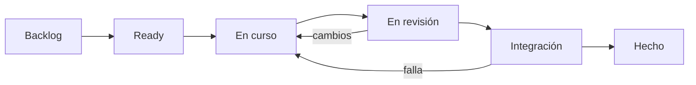

# NDcrm+ · Plan de desarrollo para dos personas

Plan completo para construir NDcrm+ según el PRD v1.0: reparto de trabajo sin colisiones, flujo por historias de usuario y calendario por sprints. **Dev A** se enfoca en plataforma y datos; **Dev B** en producto y experiencia. Este documento acompaña a `BACKLOG_NDcrm.csv` (el mismo backlog, listo para importar en un tablero).

> Versión 1.0 · 26 nov 2026 · Base: `NDcrm_PRD_v1.0.docx` y la auditoría de crm-besto. Las fechas y los puntos son **indicativos** hasta calibrar la velocidad en S2.

## Ruta rápida

1. Confirmar las decisiones D-01, D-04, D-05, D-07 y D-08 (sección 2) y poner nombre a Dev A y Dev B. El stack ya está decidido: **Next.js full-stack** (D-02).
2. Ejecutar el **Sprint 0** (sección 6): repo, CI, contratos, tablero. Nada de producto antes.
3. Cada sprint: planning → trabajar historias por el flujo de la sección 4 → demo cruzada → retro.
4. Una historia solo está **Hecha** cuando cumple la Definición de Hecho (sección 4.3) y la integración usa el API real.

## Tabla de contenido

- 1. Objetivo y alcance por release
- 2. Decisiones por confirmar
- 3. Equipo y propiedad del código
- 4. Flujo de trabajo
- 5. Estructura del repositorio
- 6. Calendario por sprints
- 7. Backlog por épica
- 8. Trazabilidad con el PRD
- 9. Riesgos y dependencias externas
- Anexo. Plantillas

## 1. Objetivo y alcance por release

**Meta:** una plataforma que cumpla el PRD completo. Como el PRD es enorme para dos personas, se entrega en **tres releases** con un corte claro. Lo que entra en cada uno se decide con una regla simple: R1 es exactamente el MVP del PRD §15; R2 completa las fases 03–07; R3 cubre las fases 08–14.

| Release | Qué entrega | Historias | Puntos A / B | Termina (sprint) | Fecha indicativa |
|---|---|---|---|---|---|
| **R1** | **MVP (PRD §15):** importar, calificar, asignar y seguir un prospecto hasta su cierre, con persistencia, historial y aislamiento verificados | 90 | 241 / 236 | S15 | 9 jul 2027 |
| **R2** | Alcance total de los módulos de las fases 03–07 (duplicados, propuestas, comisiones, calendario, tiempo real, documentos, eventos BESTO restantes) | 21 | 65 / 45 | S17 | 6 ago 2027 |
| **R3** | Discovery, comunicación, marketing, ingresos, capacidad, automatización, IA, customer success y lanzamiento SaaS | 52 | 183 / 193 | S29 | 21 ene 2028 |

**Criterio de aceptación de R1 (PRD §15):** un usuario autorizado puede importar, calificar, asignar y seguir un prospecto hasta su cierre, con persistencia, historial y aislamiento verificados. Lo comprueba la prueba E2E US-07-12 y se firma con el informe de seguridad US-07-07. Los mocks no son producción.

**Fuera de alcance de R1:** todo lo marcado R2 y R3. Si algo nuevo entra, otra cosa sale, y se anota en el registro de cambios del backlog.

**Cómo se estima.** 1 punto ≈ 2–3 horas de trabajo enfocado. Capacidad supuesta: **18 puntos por persona por sprint** de 2 semanas (≈ 45 h efectivas de 80; el resto son revisiones, reuniones e imprevistos). Ninguna historia pasa de 8 puntos: si es mayor, se divide. Se recalibra al terminar S2 y después de cada release.

## 2. Decisiones por confirmar

Estas decisiones cambian el plan. Las marcadas **Decidido** ya se resolvieron; el resto trae una recomendación. Si se decide distinto, se actualiza el ADR y las historias afectadas.

| ID | Decisión | Recomendación | Alternativa y costo |
|---|---|---|---|
| D-01 | ¿Repositorio nuevo o evolucionar crm-besto? | **Repositorio nuevo** (`ndcrm`). crm-besto queda como piloto en mantenimiento y se migra en US-07-06. Se porta casi tal cual lo bueno, porque el stack es el mismo (sesiones, límite de intentos, verificación de origen, importador). | Evolucionar crm-besto: parece más rápido, pero el modelo JSONB de una tabla, los usuarios fijos en código y la falta de tenant obligan a reescribir casi todo. |
| D-02 | ¿Stack? | **Decidido: Next.js full-stack** (App Router + route handlers) con Prisma y PostgreSQL. Criterio: lo más rápido de construir y de delegar a agentes de IA: un solo proyecto, tipos de punta a punta y el mismo stack del piloto. Queda en ADR-001. | NestJS + monorepo + Redis/BullMQ (PRD §10): más piezas y contratos entre ellas desde el día 1. Se conserva la ruta de extracción: `src/server` no depende de la interfaz, y un worker o servicio aparte se agrega cuando haga falta (R2–R3). |
| D-03 | ¿Gestor de paquetes? | **Decidido: npm**, como el piloto (un solo `package.json`). | pnpm: instala más rápido; no compensa el cambio con una sola aplicación. |
| D-04 | ¿Cómo se aísla cada organización? | **Una base compartida con `workspace_id` + RLS de PostgreSQL** como segunda barrera (ADR-002). | Base por cliente: aislamiento máximo, pero migraciones y costos se multiplican. |
| D-05 | ¿Cómo se guardan los campos personalizados? | **Columnas núcleo + JSONB validado por definiciones** (ADR-003), con índices para los atributos filtrables. | Modelo EAV (tabla de valores): más flexible, consultas más lentas y complejas. |
| D-06 | ¿Dónde se despliega? | **Decidido (provisional): Vercel + Supabase**, como el piloto. Un worker Node aparte se agrega solo cuando el tiempo real o la automatización lo exijan; Discovery (Python) siempre va como servicio aparte. | Contenedores propios (Docker, PRD §10): más control sobre WebSockets y trabajos largos, más operación desde el inicio. Revisar antes de R2. |
| D-07 | ¿Quién es Dev A y Dev B? | El reparto asume que A es más fuerte en backend y datos, y B en frontend y UX. Si es al revés, se invierten las letras; nada más cambia. | Reparto por funcionalidad completa (vertical): menos traspasos, más choques en paquetes compartidos. |
| D-08 | ¿Quién da acceso a las APIs y contratos reales de BESTO? | Un contacto técnico de BESTO nombrado antes de S5 (el PRD §12 exige validar contra las APIs existentes). | Sin contacto: US-07-04 se construye contra contratos supuestos y se reabre al validar. |

**Por qué reparto por capas y módulos y no por funcionalidades completas:** con dos personas, lo que más cuesta es pisarse los archivos. Si cada uno es dueño de rutas distintas y se hablan solo por contratos, el riesgo de conflicto baja mucho. El precio es un traspaso por historia (API → pantalla), que se controla con contratos primero y mocks mientras el API no existe.

## 3. Equipo y propiedad del código

| Rol | Foco | Es dueño de |
|---|---|---|
| **Dev A · Plataforma** | Servidor, datos, seguridad, integraciones, infraestructura | `src/server/**` (excepto los módulos de B), `src/app/api/**`, `prisma/**`, `infrastructure/**`, `services/**`, `.github/workflows/**`, `tests/integration/**` y la configuración raíz (`package.json`, `tsconfig.json`, `next.config.ts`) |
| **Dev B · Producto** | Interfaz, design system, grid, UX, E2E y los módulos de analítica | `src/app/(app)/**` y el layout raíz, `src/features/**`, `src/ui/**`, `src/lib/**`, `tests/e2e/**`, `tests/load/**`, `docs/user/**`, y los módulos `goals`, `dashboard` y `pipeline-metrics` (R1) más `marketing`, `revenue`, `customer-success` y `retention` (R3) |
| **Compartido** | El «puente» entre ambos | `src/contracts/**` y `docs/adr/**` (reglas abajo) |

**Regla de oro: una ruta, un dueño.** Los módulos de `src/server/modules/<modulo>` tienen un único dueño. Los módulos de B se asignan así para balancear la carga total (A ≈ 489 pts, B ≈ 474 pts).

### 3.1 Archivo CODEOWNERS propuesto

```
# Reemplazar @dev-a y @dev-b por los usuarios reales.
# En CODEOWNERS gana la ÚLTIMA regla que coincide: primero lo general, después lo específico.
*                                      @dev-a
/src/app/                              @dev-b
/src/features/                         @dev-b
/src/ui/                               @dev-b
/src/lib/                              @dev-b
/src/app/api/                          @dev-a
/src/server/                           @dev-a
/src/server/modules/goals/             @dev-b
/src/server/modules/dashboard/         @dev-b
/src/server/modules/pipeline-metrics/  @dev-b
/src/server/modules/marketing/         @dev-b
/src/server/modules/revenue/           @dev-b
/src/server/modules/customer-success/  @dev-b
/src/server/modules/retention/         @dev-b
/src/contracts/                        @dev-a @dev-b
/tests/e2e/                            @dev-b
/tests/load/                           @dev-b
/docs/user/                            @dev-b
/docs/adr/                             @dev-a @dev-b
/.github/CODEOWNERS                    @dev-b
/.github/PULL_REQUEST_TEMPLATE.md      @dev-b
/AGENTS.md                             @dev-a @dev-b
```

### 3.2 Zonas compartidas y quién manda

| Archivo o zona | Regla |
|---|---|
| `src/contracts` | Lo edita **quien posee la historia del endpoint**. El otro revisa y aprueba en menos de 24 h. Cambios después de fusionados: solo aditivos; un cambio incompatible lleva la etiqueta `breaking-contract` y se acuerda antes. |
| `src/app` | Las pantallas (`(app)`) son de B y los endpoints (`api/`) son de A. Un route handler es **delgado**: valida con el contrato, llama a un módulo de `src/server` y responde. |
| Límite servidor / interfaz | `src/server` nunca importa de `src/features`, `src/ui` ni de `src/app/(app)`; lo hace cumplir ESLint. Así se puede extraer el servidor a un servicio aparte (NestJS u otro) sin reescribir el dominio. |
| `prisma/schema/*.prisma` | Esquema **multi-archivo, un archivo por dominio**, dueño el del módulo. Nunca un `schema.prisma` único. |
| `prisma/migrations/` | Se generan solo desde `main` actualizado. Si dos PR traen migración, el segundo hace rebase y **regenera la suya**. Una migración ya fusionada no se edita. |
| `package-lock.json` | Nunca se resuelve a mano: ante un conflicto, se toma el de `main` y se corre `npm install`. |
| `package.json`, `tsconfig.json`, `next.config.ts` | Dueño A. B pide el cambio en un PR pequeño etiquetado `cross-owner`. |
| `src/ui/tokens` | Dueño B. |
| `docs/adr/` | Un ADR por decisión. Numeración reservada en el tablero al crear la tarjeta (A: 0001–0003, B: 0004–0005 en S0; después, el siguiente número libre). |
| Código fuera de tu ruta | PR pequeño con etiqueta `cross-owner` y el dueño como revisor; no se edita en caliente. |

### 3.3 Superficies de edición por épica

Antes de empezar una historia se confirma que ninguna otra historia en curso toca las mismas rutas. Cada épica declara su superficie:

| Épica | Dev A edita | Dev B edita |
|---|---|---|
| **E10** Revenue y Capacity Engine | `src/server/modules/{forecast,capacity}/**` | `src/server/modules/revenue/**`<br>`src/features/{revenue,capacity}/**` |
| **E11** Automation Builder | `src/server/modules/automation/**`<br>`src/server/platform/jobs/automation/**` | `src/features/automation/**` |
| **E12** AI Intelligence | `src/server/modules/ai/**` | `src/features/copilot/**` |
| **E13** Customer Success | `— (sin cambios)` | `src/server/modules/customer-success/**`<br>`src/features/customers/**` |
| **E14** SaaS Commercial Release | `src/server/modules/{signup,plans}/**`<br>`infrastructure/**` | `src/features/onboarding/**`<br>`src/server/modules/retention/**`<br>`docs/site/**` |
| **E00** Foundation y herramientas | `package.json, tsconfig.json, next.config.ts, configuración ESLint`<br>`.github/workflows/**`<br>`infrastructure/**`<br>`src/contracts/** (estructura inicial)`<br>`docs/adr/0001–0003` | `.github/CODEOWNERS, PULL_REQUEST_TEMPLATE.md`<br>`CONTRIBUTING.md, AGENTS.md`<br>`src/lib/validation/**`<br>`docs/adr/0004–0005` |
| **E01** Design System y Application Shell | `— (sin cambios; consume src/contracts)` | `src/ui/tokens/**, src/ui/components/**`<br>`src/lib/{i18n,api-client}/**`<br>`src/app/layout.tsx, src/app/(app)/layout.tsx y shell`<br>`.storybook/**` |
| **E02** Backend y fundamentos de seguridad | `src/server/platform/{auth,tenancy,permissions,audit,observability}/**`<br>`src/server/modules/team/**`<br>`src/app/api/{auth,team,audit}/**`<br>`prisma/schema/{auth,tenancy}.prisma + prisma/migrations/**`<br>`src/contracts/{auth,team,audit}/**` | `src/features/{auth,team,audit}/**`<br>`src/app/(app)/{login,settings}/**` |
| **E03** Dynamic Data Engine | `src/server/modules/{custom-fields,data-engine,views}/**`<br>`src/server/platform/realtime/**`<br>`src/app/api/{custom-fields,data-engine,views}/**`<br>`prisma/schema/data-engine.prisma`<br>`src/contracts/data-engine/**` | `src/ui/data-grid/**`<br>`src/features/{grid,attributes,views}/**`<br>`tests/load/**` |
| **E04** Companies y People | `src/server/modules/{companies,people,relationships,imports,documents}/**`<br>`src/app/api/{companies,people,imports}/**`<br>`prisma/schema/crm.prisma`<br>`src/server/platform/jobs/imports/**` | `src/features/{companies,people,imports}/**`<br>`src/lib/validation/**` |
| **E05** Leads y Pipeline | `src/server/modules/{leads,scoring,pipelines,deals,proposals}/**`<br>`src/app/api/{leads,pipelines,deals}/**`<br>`prisma/schema/sales.prisma`<br>`src/contracts/sales/**` | `src/features/{leads,pipeline,deals,proposals}/**`<br>`src/server/modules/pipeline-metrics/**` |
| **E06** Sales Execution | `src/server/modules/{tasks,activities,notifications,calendar,commissions}/**`<br>`prisma/schema/execution.prisma`<br>`src/server/platform/jobs/reminders/**` | `src/server/modules/{goals,dashboard}/**`<br>`src/features/{tasks,activity,calendar,goals,dashboard,commissions}/**` |
| **E07** Catálogo, integración BESTO y cierre del MVP | `src/server/modules/{catalog,integrations,revenue-events,customers}/**`<br>`prisma/schema/catalog.prisma`<br>`infrastructure/**`<br>`scripts/migrate-crm-besto/**` | `src/features/{catalog,integrations}/**`<br>`tests/e2e/**`<br>`docs/user/**` |
| **E08** Discovery Intelligence | `services/discovery/**`<br>`src/server/modules/discovery/**`<br>`prisma/schema/discovery.prisma` | `src/features/discovery/**` |
| **E09** Communication y Marketing | `src/server/modules/{conversations,messaging,consent}/**`<br>`src/server/platform/integrations/**` | `src/features/{inbox,campaigns}/**`<br>`src/server/modules/marketing/**` |

## 4. Flujo de trabajo

### 4.1 Ciclo de una historia

Aplica el protocolo del PRD §16 (PREFLIGHT → AUTHORIZED SCOPE → IMPLEMENTATION → TESTING → AUDIT → READY FOR COMMIT → CLOSED) con HALO: delimitar el alcance de escritura, preservar contratos y bloquear la fusión ante inconsistencias.



| Columna | Protocolo PRD §16 | Qué pasa | Sale cuando |
|---|---|---|---|
| Backlog | — | Historia escrita, sin refinar | Se refina en la sesión de refinamiento |
| **Ready** | PREFLIGHT | Cumple la Definición de Listo; baseline verde en `main` | Alguien la toma (máx. 2 por persona) |
| **En curso** | AUTHORIZED SCOPE → IMPLEMENTATION | Rama propia; se edita **solo** la superficie declarada. Prueba que falla primero cuando el criterio es verificable por máquina, luego código | Los criterios pasan en local |
| **En revisión** | TESTING → AUDIT | PR abierto; CI verde; revisión cruzada con la lista de verificación | 1 aprobación del otro dev |
| **Integración** | READY FOR COMMIT | Fusión a `main`; la UI usa el API real (se apagan los mocks); se prueba el flujo completo | Cumple la Definición de Hecho |
| **Hecho** | CLOSED | Demo al otro dev; fila de trazabilidad actualizada | — |

### 4.2 Contratos primero (cómo se trabaja en paralelo sin bloquearse)

1. **Día 1 del sprint:** quien posee el API abre un PR de **contrato** (esquemas Zod en `src/contracts` + datos de ejemplo). El otro lo revisa en menos de 24 h y se fusiona.
2. **Mientras tanto:** B construye la pantalla con **mocks MSW** generados desde el contrato. El banner `MOCK` siempre visible evita confundir demos con producto.
3. **A termina el API** y lo fusiona. Una prueba de contrato en CI verifica que las respuestas cumplan el esquema.
4. **Integración:** B apaga el mock de ese endpoint. La historia de B no se cierra hasta usar el API real.
5. En el calendario, una historia de B marcada con ⚡ comparte sprint con el API que consume: A debe fusionar ese API **antes de la mitad del sprint**.

### 4.3 Definiciones

**Definición de Listo** (para pasar a Ready):

- [ ] Criterios de aceptación claros y verificables; referencia al PRD
- [ ] Dueño, estimación (máx. 8) y dependencias resueltas o contrato fusionado
- [ ] Superficie de edición declarada y sin choque con historias en curso
- [ ] Enfoque de pruebas definido (unitaria, integración o E2E)

**Definición de Hecho** (para pasar a Hecho):

- [ ] Todos los criterios de aceptación verificados
- [ ] Pruebas unitarias y de integración; E2E si cambia un flujo de usuario
- [ ] `lint`, `typecheck`, `test` y `build` verdes en CI
- [ ] Permisos verificados **en el servidor**, con una prueba por rol afectado
- [ ] Si toca datos: prueba de aislamiento entre organizaciones
- [ ] Operaciones críticas registradas en auditoría
- [ ] Textos en ES y EN; accesibilidad por teclado y `axe` sin errores (si es UI)
- [ ] Contrato y documentación al día; ningún mock en la ruta de producción
- [ ] Demo al otro dev, PR fusionado y trazabilidad actualizada

### 4.4 Git y revisiones

| Tema | Regla |
|---|---|
| Modelo | Trunk-based: `main` siempre desplegable y protegida. Ramas cortas (idealmente menos de 2 días). |
| Nombre de rama | `feat/US-05-07-deal-api`, `fix/US-03-05-conflict-409`, `chore/US-00-02-ci`. Siempre con el ID de la historia. |
| Commits | Conventional Commits con el módulo como scope: `feat(deals): add stage transition rules`. Pie opcional `Refs: US-05-07`. Sin atribuciones de herramientas de IA. |
| Tamaño del PR | Objetivo ≈ 400 líneas cambiadas. Una historia puede ser 1–3 PR encadenados. Si pasa de 400, se explica por qué en la descripción. |
| Fusión | Squash merge. CI verde + 1 aprobación del otro dev. Nadie fusiona su propio PR sin aprobación. |
| Tiempo de revisión | Menos de 24 h hábiles. Revisar tiene prioridad sobre empezar algo nuevo. |
| Rebase | Cada mañana sobre `main`. Ramas viejas se cierran o se parten. |
| Código inconcluso | Detrás de un *feature flag* para poder fusionar a `main` sin exponerlo. |
| `main` roto | Es prioridad uno de quien lo rompió; se revierte primero y se arregla después. |

### 4.5 Ritmo del sprint (dos semanas)

| Cuándo | Qué | Duración |
|---|---|---|
| Lunes, semana 1 | **Planning:** elegir historias hasta la capacidad, declarar superficies y abrir los PR de contrato | 60 min |
| Todos los días | **Estado asíncrono** por escrito: ayer, hoy, bloqueos | 5 min |
| Lunes y jueves | **Sincronía** corta: choques de rutas, contratos y revisiones pendientes | 15 min |
| Miércoles, semana 1 | **Punto de integración:** los API que desbloquean a B (⚡) ya están en `main` | 15 min |
| Lunes, semana 2 | **Refinamiento** del siguiente sprint: divide y estima | 45 min |
| Viernes, semana 2 | **Demo cruzada y retro:** cada uno muestra lo suyo; se actualiza la velocidad | 60 min |

**Quién desempata.** El *tech lead del sprint* rota cada sprint y decide lo técnico del sprint. Las decisiones de arquitectura van a un ADR que ambos aprueban; si no hay acuerdo, decide Founder / Dev Lab.

### 4.6 Trabajo con agentes de IA

Cada dev puede apoyarse en uno o varios agentes. Estas reglas los mantienen rápidos y sin pisarse:

| Regla | Detalle |
|---|---|
| Una historia, una tarea | Se entrega al agente la ficha completa (ID, criterios, superficie, dependencias), copiada del backlog. Ver el prompt tipo en el anexo. |
| Superficie cerrada | El agente edita solo las rutas declaradas. Si necesita otra, se detiene y lo dice. |
| Prueba primero | Se le pide la prueba que falla antes del código; después el código mínimo que la pasa. |
| Contexto fijo | `AGENTS.md` en la raíz: estructura, límites servidor/interfaz, comandos y reglas de este documento. **Debe incluir la advertencia de leer `node_modules/next/dist/docs` antes de escribir código Next.js:** esta versión tiene cambios que el modelo puede no conocer. |
| Paralelo seguro | Un agente por rama (o por worktree) y por superficie. Nunca dos agentes en la misma ruta. |
| Revisión humana | El otro dev revisa el PR. El agente no fusiona ni sube a `main`. |
| Evidencia | El agente corre `npm run check` y `npm test` y reporta archivos tocados y criterios cubiertos. Sin evidencia, la historia vuelve a En curso. |

## 5. Estructura del repositorio

Un solo proyecto Next.js con carpetas por responsabilidad. Se crea lo mínimo en S0 y crece por historia.

```
ndcrm/
├─ src/
│  ├─ app/
│  │  ├─ (app)/            pantallas autenticadas (B)
│  │  └─ api/              route handlers delgados (A)
│  ├─ features/<modulo>/   UI por módulo (B)
│  ├─ ui/                  tokens, componentes y data-grid (B)
│  ├─ lib/                 i18n, validation, api-client (B)
│  ├─ contracts/           esquemas Zod, datos de ejemplo y mocks (compartido)
│  └─ server/
│     ├─ modules/<modulo>/ dominio, casos de uso y repositorios (dueño por módulo)
│     ├─ platform/         auth, permissions, tenancy, audit, jobs, integrations (A)
│     └─ db/               cliente Prisma (A)
├─ prisma/                 schema/ (un .prisma por dominio) y migrations/ (A)
├─ services/discovery/     Python + Playwright (A, R3)
├─ infrastructure/         despliegue y copias (A)
├─ scripts/                migración del piloto y utilidades (A)
├─ tests/                  e2e/ y load/ (B), integration/ (A)
├─ docs/                   adr/ y user/
├─ AGENTS.md               reglas para agentes de IA
└─ .github/                workflows/ (A), CODEOWNERS y plantillas (B)
```

**Qué se simplifica frente al PRD §10:** un solo despliegue en lugar de monorepo con NestJS, y cola de trabajos sobre PostgreSQL en lugar de Redis/BullMQ en R1. Un worker Node aparte y Redis se agregan cuando una historia lo exija (tiempo real, automatización en R3). El resto del stack del PRD se mantiene: React, TypeScript estricto, Tailwind, Radix, TanStack, React Hook Form, Zod, Recharts, Prisma, PostgreSQL, Vitest y Playwright.

## 6. Calendario por sprints

Sprints de 2 semanas desde el **30 nov 2026** (S0 con capacidad reducida de 12 pts por persona; el resto, 18). Las fechas son indicativas: ajustar por festivos y vacaciones, en especial a fin de año.

### 6.1 Hitos

| Hito | Qué demuestra | Termina | Fecha indicativa |
|---|---|---|---|
| **H1** | Cimientos: shell, seguridad multi-tenant, RBAC y contratos | S4 | 5 feb 2027 |
| **H2** | Motor de datos usable (grid, atributos, vistas) | S6 | 5 mar 2027 |
| **H3** | Relaciones: empresas, personas, importación y Customer 360° | S8 | 2 abr 2027 |
| **H4** | Ventas: prospectos, puntaje y pipeline Kanban | S11 | 14 may 2027 |
| **H5** | Ejecución comercial: tareas, objetivos y Command Center | S13 | 11 jun 2027 |
| **R1** | MVP aceptado (PRD §15): catálogo, BESTO, seguridad, despliegue y E2E | S15 | 9 jul 2027 |
| **R2** | Fases 03–07 completas (alcance total de cada módulo) | S17 | 6 ago 2027 |
| **R3** | Fases 08–14 (Discovery, comunicación, ingresos, automatización, IA, CS, SaaS) | S29 | 21 ene 2028 |

### 6.2 Plan sprint por sprint

⚡ = la historia de B comparte sprint con el API de A que consume (A lo fusiona antes de la mitad del sprint). Las historias R2 y R3 se re-planifican al cerrar R1.

**Puntos libres.** Cuando una columna suma menos de 18, la diferencia es colchón: B espera a que A publique APIs (S5, S6, S8) y A espera pantallas para integrar. Ese tiempo se usa para imprevistos, deuda técnica, revisiones del PR del otro y, si el planning lo decide, para adelantar una historia R2. No se rellena automáticamente.

| Sprint | Fechas | Dev A | Dev B | Pts A / B | Hito |
|---|---|---|---|---|---|
| **S0** | 30 nov 2026 – 11 dic 2026 | 00-01 Proyecto base y herramientas (2)<br>00-02 Integración continua (3)<br>00-03 Infraestructura local con Docker (2)<br>00-09 Contratos compartidos y mocks (3)<br>00-05 ADRs de arquitectura (2) | 00-06 ADRs de producto y cliente (2)<br>00-04 Convenciones y protección del repositorio (2)<br>00-08 Tablero y backlog inicial (2)<br>04-07 Validación de datos (3)<br>01-01 Tokens de diseño y temas (3) ⚡ | 12 / 12 |  |
| **S1** | 14 dic 2026 – 25 dic 2026 | 00-07 Inventario de reuso del piloto (2)<br>02-01 Base del servidor y de los endpoints (3)<br>02-02 Esquema base y migraciones (8)<br>02-12 Observabilidad base (3) | 01-02 Componentes base documentados (8)<br>01-03 Shell de la aplicación (5)<br>01-04 Selector de organización y navegación (3)<br>01-09 Estados vacíos, de carga y de error (2) | 16 / 18 |  |
| **S2** | 28 dic 2026 – 8 ene 2027 | 02-03 Aislamiento multi-tenant (8)<br>02-04 Autenticación (8) | 01-05 Paleta de comandos y búsqueda universal (5)<br>01-06 Internacionalización ES/EN (3)<br>01-07 Accesibilidad base (3)<br>01-08 Cliente de API tipado y mocks (5) | 16 / 16 |  |
| **S3** | 11 ene 2027 – 22 ene 2027 | 02-05 Autenticación en dos pasos (5)<br>02-06 RBAC granular configurable (8)<br>02-07 Registro de auditoría (5) | 02-09 Pantallas de acceso (5)<br>02-11 Pantalla de auditoría (3) ⚡<br>03-07a Grid virtualizado base (8) | 18 / 16 |  |
| **S4** | 25 ene 2027 – 5 feb 2027 | 02-08 API de equipo (5)<br>03-01 Definición de atributos personalizados (8)<br>04-01 Empresas (5) | 02-10 Pantalla de equipo y roles (5) ⚡<br>03-07b Columnas dinámicas y selección (5)<br>03-08a Editores de tipos esenciales (8) | 18 / 18 | **H1** |
| **S5** | 8 feb 2027 – 19 feb 2027 | 03-02 Almacenamiento y consulta de valores (8)<br>03-03a Motor de consulta del servidor (8) | 03-11 Gestión de atributos personalizados (5)<br>03-14 Prueba de carga con 100.000 registros (3) ⚡ | 16 / 8 |  |
| **S6** | 22 feb 2027 – 5 mar 2027 | 03-04 Vistas guardadas (5)<br>03-05 Edición inline, masiva y conflictos (8)<br>07-15 Despliegue, copias y recuperación (5) | 03-09 Filtros, orden, agrupación y vistas (8) ⚡<br>03-13 Historial de cambios en el inspector (3) ⚡ | 18 / 11 | **H2** |
| **S7** | 8 mar 2027 – 19 mar 2027 | 04-03 Personas (8)<br>04-04 Relaciones persona–empresa (5)<br>04-08 API de perfil 360° (5) | 04-10 Tablas de empresas y contactos (5) ⚡<br>04-11 Perfil 360° de empresa (8) ⚡<br>04-12 Ficha de persona y consentimientos (5) ⚡ | 18 / 18 |  |
| **S8** | 22 mar 2027 – 2 abr 2027 | 04-06 Importación y exportación (8)<br>05-01 Prospectos (8) | 04-14 Asistente de importación y exportación (8) ⚡<br>04-15 Archivar y restaurar (2) | 16 / 10 | **H3** |
| **S9** | 5 abr 2027 – 16 abr 2027 | 05-02 Puntaje configurable de 0 a 100 (8)<br>05-03 Asignación individual, masiva y territorial (5)<br>05-04 Calificación y motivos de descarte (5) | 05-10 Tabla de prospectos (5) ⚡<br>05-11 Formulario y calificación de prospecto (5) ⚡<br>05-12 Configuración de puntaje y motivos (5) ⚡ | 18 / 15 |  |
| **S10** | 19 abr 2027 – 30 abr 2027 | 05-06 Pipelines y etapas configurables (8)<br>05-07 Oportunidades (Deal) (8) | 05-09 Métricas de pipeline (5) ⚡<br>05-13 Kanban de oportunidades (8) ⚡<br>05-14 Vista tabular y editor de etapas (5) ⚡ | 16 / 18 |  |
| **S11** | 3 may 2027 – 14 may 2027 | 05-05 Conversión de prospecto a oportunidad (5)<br>06-01 Tareas y actividades (8)<br>06-03 Seguimientos y notificaciones (5) | 05-15 Ficha de oportunidad (8)<br>05-17 Conversión de prospecto en la interfaz (2) ⚡<br>06-04 Objetivos comerciales (API) (5)<br>06-11 Centro de notificaciones (3) ⚡ | 18 / 18 | **H4** |
| **S12** | 17 may 2027 – 28 may 2027 | 07-01 Catálogo de productos (8)<br>07-02 Productos iniciales de BESTO (2)<br>07-03 Base de integraciones (8) | 06-06 API del Command Center (8)<br>06-08 Pantalla de tareas (5)<br>06-09 Línea de tiempo de actividad (5) | 18 / 18 |  |
| **S13** | 31 may 2027 – 11 jun 2027 | 07-04 Eventos de BESTO (primera parte) (8)<br>07-05 Registro de ingresos confirmados (5)<br>07-06 Migración de datos del piloto (5) | 06-12 Pantalla de objetivos (3)<br>06-13 Command Center (8)<br>07-10 Pantalla de integraciones (5) ⚡ | 18 / 16 | **H5** |
| **S14** | 14 jun 2027 – 25 jun 2027 | 03-03b Agrupación y búsqueda de texto (5) · R2<br>03-06 Colaboración en tiempo real (5) · R2<br>04-02 Sucursales (3) · R2<br>07-07 Endurecimiento de seguridad (5) | 07-09 Catálogo en la interfaz (8)<br>07-12 Pruebas E2E del criterio de aceptación (8) | 18 / 16 |  |
| **S15** | 28 jun 2027 – 9 jul 2027 | 04-05 Duplicados y fusión (8) · R2<br>04-09 Documentos (5) · R2<br>05-18 Prospectos abandonados (3) · R2 | 03-08b Editores de tipos avanzados (5) · R2<br>03-10 Copiar y pegar, edición masiva y atajos (5) · R2<br>07-13 Pulido y rendimiento del MVP (5)<br>07-14 Guía de usuario y puesta en marcha del piloto (3) | 16 / 18 | **R1** |
| **S16** | 12 jul 2027 – 23 jul 2027 | 05-08 Propuestas económicas (8) · R2<br>06-02 Calendario y demos (5) · R2<br>06-07 Rendimiento, alertas y proyección (5) · R2 | 03-12 Presencia y resolución de conflictos (5) · R2<br>04-13 Pantalla de duplicados y fusión (5) · R2<br>05-16 Editor de propuestas y aprobaciones (8) · R2 ⚡ | 18 / 18 |  |
| **S17** | 26 jul 2027 – 6 ago 2027 | 06-05 Comisiones (8) · R2<br>07-16 Eventos de BESTO (segunda parte) (5) · R2<br>07-17 Aprobación de cambios de precio (5) · R2 | 06-10 Calendario (8) · R2<br>06-14 Vista de equipo (3) · R2<br>06-15 Pantalla de comisiones (3) · R2 ⚡<br>07-18 Aprobaciones de precio en la interfaz (3) · R2 ⚡ | 18 / 17 | **R2** |
| **S18** | 9 ago 2027 – 20 ago 2027 | 08-01 Servicio de descubrimiento (8) · R3<br>08-02 Fuentes y trazabilidad (5) · R3 | 09-07 Campañas, formularios y atribución (8) · R3<br>09-08 Meta Ads, Google Ads y costos (8) · R3 | 13 / 16 |  |
| **S19** | 23 ago 2027 – 3 sep 2027 | 08-03 Conectores de APIs autorizadas (8) · R3<br>08-08 Extracción de fuentes permitidas (5) · R3 | 08-06 Búsqueda y mapa de oportunidades (8) · R3 ⚡<br>09-09 Campañas en la interfaz (8) · R3 | 13 / 16 |  |
| **S20** | 6 sep 2027 – 17 sep 2027 | 08-04 Normalización, duplicados y enriquecimiento (8) · R3<br>08-05 Potencial y asignación territorial (5) · R3 | 08-07 Cola de revisión e importación selectiva (8) · R3 ⚡<br>10-01 Ingresos recurrentes y por producto (8) · R3 | 13 / 16 |  |
| **S21** | 20 sep 2027 – 1 oct 2027 | 09-01 Conversaciones y bandeja unificada (8) · R3<br>09-02 WhatsApp Business API (8) · R3 | 09-05 Bandeja en la interfaz (8) · R3 ⚡<br>09-06 Llamadas y demos desde la conversación (5) · R3<br>14-04 Retención y eliminación controlada (5) · R3 | 16 / 18 |  |
| **S22** | 4 oct 2027 – 15 oct 2027 | 09-03 Gmail y Outlook (8) · R3<br>09-04 Plantillas, consentimiento y límites (8) · R3 | 09-10 Plantillas y consentimiento en la interfaz (5) · R3 ⚡<br>10-02 CAC, LTV, retención e ingresos perdidos (8) · R3<br>14-06 Revisión final de accesibilidad e i18n (5) · R3 | 16 / 18 |  |
| **S23** | 18 oct 2027 – 29 oct 2027 | 10-03 Pronóstico, simulación y escenarios (8) · R3<br>10-04 Motor de capacidad (8) · R3 | 10-05 Pantalla de ingresos (8) · R3<br>10-06 Planificador de capacidad y escenarios (8) · R3 ⚡ | 16 / 16 |  |
| **S24** | 1 nov 2027 – 12 nov 2027 | 11-01 Modelo de flujos y bus de eventos (8) · R3<br>11-02 Motor de ejecución (8) · R3 | 11-05 Constructor visual (8) · R3 ⚡<br>11-06 Propiedades y validación de nodos (5) · R3<br>14-07 Sitio de documentación (3) · R3 | 16 / 16 |  |
| **S25** | 15 nov 2027 – 26 nov 2027 | 11-03 Reintentos, idempotencia y pausa (8) · R3<br>11-04 Acciones, simulación y aprobación humana (8) · R3 | 11-07 Historial, simulación y aprobaciones (8) · R3 ⚡<br>13-01 Clientes, suscripción y salud (8) · R3 | 16 / 16 |  |
| **S26** | 29 nov 2027 – 10 dic 2027 | 12-01 Servicio de IA con permisos y costos (8) · R3<br>12-02 Consultas en lenguaje natural (8) · R3 | 12-06 Copiloto en la interfaz (8) · R3 ⚡<br>12-07 Citas y confirmación de acciones (5) · R3<br>13-04 Encuestas, solicitudes y baja utilización (5) · R3 | 16 / 18 |  |
| **S27** | 13 dic 2027 – 24 dic 2027 | 12-03 Resúmenes y recomendaciones (8) · R3<br>12-04 Objeciones, borradores y reuniones (8) · R3 | 13-02 Onboarding, activación y renovaciones (8) · R3<br>13-03 Cancelaciones, recuperación y expansión (8) · R3 | 16 / 16 |  |
| **S28** | 27 dic 2027 – 7 ene 2028 | 12-05 Oportunidades, cancelación y objetivos (8) · R3<br>14-01 Alta de organización en autoservicio (8) · R3 | 13-05 Clientes 360 (8) · R3<br>13-06 Onboarding, renovaciones y recuperación en la interfaz (8) · R3 | 16 / 16 |  |
| **S29** | 10 ene 2028 – 21 ene 2028 | 14-02 Planes y límites de NDcrm+ (8) · R3<br>14-03 Escalabilidad y recuperación (8) · R3 | 13-07 Encuestas y solicitudes en la interfaz (3) · R3<br>14-05 Onboarding guiado y plantillas (8) · R3 | 16 / 11 | **R3** |

### 6.3 Carga por épica

| Épica | Release | Pts A | Pts B | Sprints |
|---|---|---|---|---|
| E10 Revenue y Capacity Engine | R3 | 16 | 32 | S20–S23 |
| E11 Automation Builder | R3 | 32 | 21 | S24–S25 |
| E12 AI Intelligence | R3 | 40 | 13 | S26–S28 |
| E13 Customer Success | R3 | 0 | 48 | S25–S29 |
| E14 SaaS Commercial Release | R3 | 24 | 21 | S21–S29 |
| E00 Foundation y herramientas | R1 | 14 | 6 | S0–S1 |
| E01 Design System y Application Shell | R1 | 0 | 37 | S0–S2 |
| E02 Backend y fundamentos de seguridad | R1 | 53 | 13 | S1–S4 |
| E03 Dynamic Data Engine | R1 + R2 | 47 | 55 | S3–S16 |
| E04 Companies y People | R1 + R2 | 47 | 36 | S0–S16 |
| E05 Leads y Pipeline | R1 + R2 | 58 | 51 | S8–S16 |
| E06 Sales Execution | R1 + R2 | 31 | 51 | S11–S17 |
| E07 Catálogo, integración BESTO y cierre del MVP | R1 + R2 | 56 | 32 | S6–S17 |
| E08 Discovery Intelligence | R3 | 39 | 16 | S18–S20 |
| E09 Communication y Marketing | R3 | 32 | 42 | S18–S22 |

Total: **Dev A 489 pts**, **Dev B 474 pts**. Si al calibrar en S2 la velocidad real es menor a 18, las fechas se corren; el orden y los hitos no cambian.

## 7. Backlog por épica

Cada épica lista sus historias en una tabla y, debajo, la ficha de cada una con criterios de aceptación. Las historias de R3 se detallan más al cerrar R1. **Prioridad:** R1 = imprescindible para el MVP, R2 = completa la fase, R3 = fases siguientes.

### E10 · Revenue y Capacity Engine

**Fase 10** · MRR, ARR, pronósticos y planificación inversa de capacidad.

| ID | Historia | Dueño | Pts | Release | Sprint | Depende de |
|---|---|---|---|---|---|---|
| US-10-01 | Ingresos recurrentes y por producto | B | 8 | R3 | S20 | 07-05, 05-07 |
| US-10-02 | CAC, LTV, retención e ingresos perdidos | B | 8 | R3 | S22 | 10-01, 09-08 |
| US-10-03 | Pronóstico, simulación y escenarios | A | 8 | R3 | S23 | 10-01, 06-04 |
| US-10-04 | Motor de capacidad | A | 8 | R3 | S23 | 06-04, 06-01 |
| US-10-05 | Pantalla de ingresos | B | 8 | R3 | S23 | 10-01, 10-02 |
| US-10-06 | Planificador de capacidad y escenarios | B | 8 | R3 | S23 | 10-03, 10-04 |

<details>
<summary><b>US-10-01</b> · Ingresos recurrentes y por producto · Dev B · 8 pts · R3 · S20</summary>

> Como Presidencia, quiero MRR, ARR e ingresos por producto y vendedor, para entender el negocio.

- **PRD:** RE-01, RE-02, RE-03, RE-04, RE-06
- **Depende de:** US-07-05, US-05-07
- **Criterios de aceptación:**
  - [ ] MRR, ARR, ingresos por producto, por vendedor y transaccionales

</details>

<details>
<summary><b>US-10-02</b> · CAC, LTV, retención e ingresos perdidos · Dev B · 8 pts · R3 · S22</summary>

> Como Presidencia, quiero CAC, LTV y churn, para decidir dónde invertir.

- **PRD:** RE-09, RE-10, RE-11
- **Depende de:** US-10-01, US-09-08
- **Criterios de aceptación:**
  - [ ] CAC y LTV, churn y retención, ingresos perdidos

</details>

<details>
<summary><b>US-10-03</b> · Pronóstico, simulación y escenarios · Dev A · 8 pts · R3 · S23</summary>

> Como Presidencia, quiero simular objetivos y comparar escenarios, para planificar.

- **PRD:** RE-07, RE-08, RE-12, RE-13
- **Depende de:** US-10-01, US-06-04
- **Criterios de aceptación:**
  - [ ] Pronóstico mensual, simulación de objetivos, punto de equilibrio y comparación de escenarios

</details>

<details>
<summary><b>US-10-04</b> · Motor de capacidad · Dev A · 8 pts · R3 · S23</summary>

> Como encargado de ventas, quiero saber cuántos prospectos, contactos y demos necesito para una meta, para planificar la carga.

- **PRD:** §9
- **Depende de:** US-06-04, US-06-01
- **Criterios de aceptación:**
  - [ ] Planificación inversa con redondeo hacia arriba y distribución por vendedor y días hábiles; incluye horas, carga, presupuesto y viabilidad; estimado separado de real
  - [ ] El caso del PRD §9 (50 ventas, cierre 25 %, demo 20 %, contacto 60 %) reproduce 200 demos, 1.000 contactos y 1.667 prospectos

</details>

<details>
<summary><b>US-10-05</b> · Pantalla de ingresos · Dev B · 8 pts · R3 · S23</summary>

> Como Presidencia, quiero ver los ingresos en pantalla, para seguirlos cada mes.

- **PRD:** RE-01, RE-03, RE-04
- **Depende de:** US-10-01, US-10-02
- **Criterios de aceptación:**
  - [ ] Tableros de MRR, ARR, ingresos por producto y por vendedor

</details>

<details>
<summary><b>US-10-06</b> · Planificador de capacidad y escenarios · Dev B · 8 pts · R3 · S23</summary>

> Como encargado de ventas, quiero un planificador interactivo, para probar metas antes de fijarlas.

- **PRD:** RE-07, RE-13, §9
- **Depende de:** US-10-03, US-10-04
- **Criterios de aceptación:**
  - [ ] Planificador interactivo y comparación de escenarios

</details>

### E11 · Automation Builder

**Fase 11** · Workflows visuales, reglas y eventos con ejecución segura.

| ID | Historia | Dueño | Pts | Release | Sprint | Depende de |
|---|---|---|---|---|---|---|
| US-11-01 | Modelo de flujos y bus de eventos | A | 8 | R3 | S24 | 07-03 |
| US-11-02 | Motor de ejecución | A | 8 | R3 | S24 | 11-01 |
| US-11-03 | Reintentos, idempotencia y pausa | A | 8 | R3 | S25 | 11-02 |
| US-11-04 | Acciones, simulación y aprobación humana | A | 8 | R3 | S25 | 11-02, 06-01, 05-03 |
| US-11-05 | Constructor visual | B | 8 | R3 | S24 | 11-01 |
| US-11-06 | Propiedades y validación de nodos | B | 5 | R3 | S24 | 11-05 |
| US-11-07 | Historial, simulación y aprobaciones | B | 8 | R3 | S25 | 11-03, 11-04 |

<details>
<summary><b>US-11-01</b> · Modelo de flujos y bus de eventos · Dev A · 8 pts · R3 · S24</summary>

> Como equipo, quiero un modelo de flujos y eventos de dominio, para automatizar sin acoplar módulos.

- **PRD:** AU-02, AU-08
- **Depende de:** US-07-03
- **Criterios de aceptación:**
  - [ ] Workflow, Trigger, Action y Execution; eventos de dominio publicados por los módulos

</details>

<details>
<summary><b>US-11-02</b> · Motor de ejecución · Dev A · 8 pts · R3 · S24</summary>

> Como encargado de ventas, quiero flujos con condiciones y ramas, para automatizar mi proceso.

- **PRD:** AU-03, AU-04
- **Depende de:** US-11-01
- **Criterios de aceptación:**
  - [ ] Condiciones, ramificaciones y acciones programadas sobre la cola de trabajos (ADR: worker Node con pg-boss o BullMQ)

</details>

<details>
<summary><b>US-11-03</b> · Reintentos, idempotencia y pausa · Dev A · 8 pts · R3 · S25</summary>

> Como equipo, quiero ejecuciones seguras, para no duplicar acciones.

- **PRD:** AU-09, AU-12
- **Depende de:** US-11-02
- **Criterios de aceptación:**
  - [ ] Reintentos, prevención de duplicados, pausa y reactivación

</details>

<details>
<summary><b>US-11-04</b> · Acciones, simulación y aprobación humana · Dev A · 8 pts · R3 · S25</summary>

> Como encargado de ventas, quiero simular y aprobar antes de ejecutar, para evitar errores.

- **PRD:** AU-05, AU-06, AU-07, AU-10, AU-11
- **Depende de:** US-11-02, US-06-01, US-05-03
- **Criterios de aceptación:**
  - [ ] Asignación automática, tareas, flujos de seguimiento, simulación previa y aprobación humana

</details>

<details>
<summary><b>US-11-05</b> · Constructor visual · Dev B · 8 pts · R3 · S24</summary>

> Como encargado de ventas, quiero armar flujos arrastrando nodos, para automatizar sin código.

- **PRD:** AU-01
- **Depende de:** US-11-01
- **Criterios de aceptación:**
  - [ ] Constructor con React Flow y paleta de triggers, condiciones y acciones

</details>

<details>
<summary><b>US-11-06</b> · Propiedades y validación de nodos · Dev B · 5 pts · R3 · S24</summary>

> Como encargado de ventas, quiero configurar cada nodo con validación, para no publicar flujos rotos.

- **PRD:** AU-01, AU-03
- **Depende de:** US-11-05
- **Criterios de aceptación:**
  - [ ] Panel de propiedades por nodo con validación antes de activar

</details>

<details>
<summary><b>US-11-07</b> · Historial, simulación y aprobaciones · Dev B · 8 pts · R3 · S25</summary>

> Como encargado de ventas, quiero ver ejecuciones y aprobar acciones, para controlar la automatización.

- **PRD:** AU-08, AU-10, AU-11
- **Depende de:** US-11-03, US-11-04
- **Criterios de aceptación:**
  - [ ] Historial de ejecuciones, simulación y bandeja de aprobaciones

</details>

### E12 · AI Intelligence

**Fase 12** · Copiloto y recomendaciones con permisos, costos y auditoría.

| ID | Historia | Dueño | Pts | Release | Sprint | Depende de |
|---|---|---|---|---|---|---|
| US-12-01 | Servicio de IA con permisos y costos | A | 8 | R3 | S26 | 02-07, 00-03 |
| US-12-02 | Consultas en lenguaje natural | A | 8 | R3 | S26 | 12-01, 03-03b |
| US-12-03 | Resúmenes y recomendaciones | A | 8 | R3 | S27 | 12-01, 05-02 |
| US-12-04 | Objeciones, borradores y reuniones | A | 8 | R3 | S27 | 12-01, 09-01 |
| US-12-05 | Oportunidades, cancelación y objetivos | A | 8 | R3 | S28 | 12-01, 13-01, 10-03 |
| US-12-06 | Copiloto en la interfaz | B | 8 | R3 | S26 | 12-02 |
| US-12-07 | Citas y confirmación de acciones | B | 5 | R3 | S26 | 12-06 |

<details>
<summary><b>US-12-01</b> · Servicio de IA con permisos y costos · Dev A · 8 pts · R3 · S26</summary>

> Como Founder, quiero IA que respete permisos y costos, para usarla sin riesgo.

- **PRD:** AI-12, AI-13, AI-14
- **Depende de:** US-02-07, US-00-03
- **Criterios de aceptación:**
  - [ ] Integración con OpenAI y pgvector; respeta los permisos del usuario; control de consumo y costos; auditoría de cada acción

</details>

<details>
<summary><b>US-12-02</b> · Consultas en lenguaje natural · Dev A · 8 pts · R3 · S26</summary>

> Como Founder, quiero preguntar en lenguaje natural, para obtener respuestas sustentadas en datos.

- **PRD:** AI-01, AI-11
- **Depende de:** US-12-01, US-03-03b
- **Criterios de aceptación:**
  - [ ] Respuestas con citas de datos; no cambia precios, no envía propuestas vinculantes, no elimina registros ni ejecuta campañas sin permiso y confirmación

</details>

<details>
<summary><b>US-12-03</b> · Resúmenes y recomendaciones · Dev A · 8 pts · R3 · S27</summary>

> Como vendedor, quiero un resumen diario y recomendaciones, para saber a quién contactar primero.

- **PRD:** AI-02, AI-03, AI-04
- **Depende de:** US-12-01, US-05-02
- **Criterios de aceptación:**
  - [ ] Resúmenes ejecutivos diarios, recomendaciones comerciales y clasificación de prospectos

</details>

<details>
<summary><b>US-12-04</b> · Objeciones, borradores y reuniones · Dev A · 8 pts · R3 · S27</summary>

> Como vendedor, quiero ayuda con objeciones, borradores y resúmenes de reunión, para ahorrar tiempo.

- **PRD:** AI-05, AI-06, AI-07
- **Depende de:** US-12-01, US-09-01
- **Criterios de aceptación:**
  - [ ] Análisis de objeciones, borradores comerciales y resumen de reuniones

</details>

<details>
<summary><b>US-12-05</b> · Oportunidades, cancelación y objetivos · Dev A · 8 pts · R3 · S28</summary>

> Como Presidencia, quiero predicciones y planes de objetivos, para anticiparme.

- **PRD:** AI-08, AI-09, AI-10
- **Depende de:** US-12-01, US-13-01, US-10-03
- **Criterios de aceptación:**
  - [ ] Identificación de oportunidades, predicción de cancelación y planificación de objetivos

</details>

<details>
<summary><b>US-12-06</b> · Copiloto en la interfaz · Dev B · 8 pts · R3 · S26</summary>

> Como vendedor, quiero un panel de copiloto, para consultar sin salir del trabajo.

- **PRD:** AI-01, AI-11
- **Depende de:** US-12-02
- **Criterios de aceptación:**
  - [ ] Panel de copiloto con conversación y atajo desde la paleta de comandos

</details>

<details>
<summary><b>US-12-07</b> · Citas y confirmación de acciones · Dev B · 5 pts · R3 · S26</summary>

> Como Founder, quiero ver las fuentes y confirmar acciones, para confiar en la IA.

- **PRD:** AI-11, AI-14
- **Depende de:** US-12-06
- **Criterios de aceptación:**
  - [ ] Citas de datos visibles y confirmación obligatoria de acciones

</details>

### E13 · Customer Success

**Fase 13** · Onboarding, renovación, salud del cliente y recuperación.

| ID | Historia | Dueño | Pts | Release | Sprint | Depende de |
|---|---|---|---|---|---|---|
| US-13-01 | Clientes, suscripción y salud | B | 8 | R3 | S25 | 07-05 |
| US-13-02 | Onboarding, activación y renovaciones | B | 8 | R3 | S27 | 13-01, 07-16 |
| US-13-03 | Cancelaciones, recuperación y expansión | B | 8 | R3 | S27 | 13-02 |
| US-13-04 | Encuestas, solicitudes y baja utilización | B | 5 | R3 | S26 | 13-01 |
| US-13-05 | Clientes 360 | B | 8 | R3 | S28 | 13-01 |
| US-13-06 | Onboarding, renovaciones y recuperación en la interfaz | B | 8 | R3 | S28 | 13-02, 13-03 |
| US-13-07 | Encuestas y solicitudes en la interfaz | B | 3 | R3 | S29 | 13-04 |

<details>
<summary><b>US-13-01</b> · Clientes, suscripción y salud · Dev B · 8 pts · R3 · S25</summary>

> Como Customer Success, quiero ver el estado de cada cliente, para detectar riesgos.

- **PRD:** CS-01, CS-04, CS-12
- **Depende de:** US-07-05
- **Criterios de aceptación:**
  - [ ] Customer, SubscriptionReference y HealthScore

</details>

<details>
<summary><b>US-13-02</b> · Onboarding, activación y renovaciones · Dev B · 8 pts · R3 · S27</summary>

> Como Customer Success, quiero seguir la activación y las renovaciones, para retener.

- **PRD:** CS-02, CS-03, CS-05
- **Depende de:** US-13-01, US-07-16
- **Criterios de aceptación:**
  - [ ] Onboarding, seguimiento de activación y renovaciones

</details>

<details>
<summary><b>US-13-03</b> · Cancelaciones, recuperación y expansión · Dev B · 8 pts · R3 · S27</summary>

> Como Customer Success, quiero gestionar bajas y oportunidades de venta cruzada, para crecer la cuenta.

- **PRD:** CS-09, CS-10, CS-11
- **Depende de:** US-13-02
- **Criterios de aceptación:**
  - [ ] Cancelaciones, recuperación de clientes, cross-selling y upselling

</details>

<details>
<summary><b>US-13-04</b> · Encuestas, solicitudes y baja utilización · Dev B · 5 pts · R3 · S26</summary>

> Como Customer Success, quiero encuestas y alertas de uso, para intervenir a tiempo.

- **PRD:** CS-06, CS-07, CS-08
- **Depende de:** US-13-01
- **Criterios de aceptación:**
  - [ ] Encuestas de satisfacción, solicitudes de servicio y alertas de baja utilización

</details>

<details>
<summary><b>US-13-05</b> · Clientes 360 · Dev B · 8 pts · R3 · S28</summary>

> Como Customer Success, quiero una vista 360° del cliente, para llegar informado.

- **PRD:** CS-01, CS-04, CS-12
- **Depende de:** US-13-01
- **Criterios de aceptación:**
  - [ ] Vista 360° con suscripción, salud, actividad y solicitudes

</details>

<details>
<summary><b>US-13-06</b> · Onboarding, renovaciones y recuperación en la interfaz · Dev B · 8 pts · R3 · S28</summary>

> Como Customer Success, quiero tableros de ciclo de vida, para priorizar mi día.

- **PRD:** CS-02, CS-03, CS-05, CS-09, CS-11
- **Depende de:** US-13-02, US-13-03
- **Criterios de aceptación:**
  - [ ] Tableros de onboarding, renovaciones y recuperación

</details>

<details>
<summary><b>US-13-07</b> · Encuestas y solicitudes en la interfaz · Dev B · 3 pts · R3 · S29</summary>

> Como Customer Success, quiero gestionar encuestas y solicitudes, para cerrar el ciclo.

- **PRD:** CS-06, CS-07
- **Depende de:** US-13-04
- **Criterios de aceptación:**
  - [ ] Pantallas de encuestas y solicitudes de servicio

</details>

### E14 · SaaS Commercial Release

**Fase 14** · Autoservicio, planes, escalabilidad y cierre de accesibilidad.

| ID | Historia | Dueño | Pts | Release | Sprint | Depende de |
|---|---|---|---|---|---|---|
| US-14-01 | Alta de organización en autoservicio | A | 8 | R3 | S28 | 02-08 |
| US-14-02 | Planes y límites de NDcrm+ | A | 8 | R3 | S29 | 14-01 |
| US-14-03 | Escalabilidad y recuperación | A | 8 | R3 | S29 | 07-15, 03-14 |
| US-14-04 | Retención y eliminación controlada | B | 5 | R3 | S21 | 02-07, 04-03 |
| US-14-05 | Onboarding guiado y plantillas | B | 8 | R3 | S29 | 14-01 |
| US-14-06 | Revisión final de accesibilidad e i18n | B | 5 | R3 | S22 | 01-07, 07-13 |
| US-14-07 | Sitio de documentación | B | 3 | R3 | S24 | 07-14 |

<details>
<summary><b>US-14-01</b> · Alta de organización en autoservicio · Dev A · 8 pts · R3 · S28</summary>

> Como nuevo cliente, quiero crear mi organización sin ayuda, para empezar a usar NDcrm+.

- **PRD:** §8
- **Depende de:** US-02-08
- **Criterios de aceptación:**
  - [ ] Registro de organización con plan de prueba, datos semilla y roles por defecto

</details>

<details>
<summary><b>US-14-02</b> · Planes y límites de NDcrm+ · Dev A · 8 pts · R3 · S29</summary>

> Como Dev Lab, quiero planes y límites por organización, para comercializar la plataforma.

- **PRD:** —
- **Depende de:** US-14-01
- **Criterios de aceptación:**
  - [ ] Planes, medición de uso y límites por organización

</details>

<details>
<summary><b>US-14-03</b> · Escalabilidad y recuperación · Dev A · 8 pts · R3 · S29</summary>

> Como Dev Lab, quiero validar disponibilidad y recuperación, para comprometer un nivel de servicio.

- **PRD:** RNF-01, RNF-02, RNF-08, RNF-14
- **Depende de:** US-07-15, US-03-14
- **Criterios de aceptación:**
  - [ ] Pruebas de carga y recuperación; escalado horizontal de la aplicación y los workers; objetivos de disponibilidad y latencia validados

</details>

<details>
<summary><b>US-14-04</b> · Retención y eliminación controlada · Dev B · 5 pts · R3 · S21</summary>

> Como Founder, quiero políticas de retención y eliminación, para cumplir con los datos personales.

- **PRD:** RNF-13
- **Depende de:** US-02-07, US-04-03
- **Criterios de aceptación:**
  - [ ] Políticas de retención y eliminación controlada con auditoría

</details>

<details>
<summary><b>US-14-05</b> · Onboarding guiado y plantillas · Dev B · 8 pts · R3 · S29</summary>

> Como nuevo cliente, quiero un recorrido guiado, para ver valor el primer día.

- **PRD:** —
- **Depende de:** US-14-01
- **Criterios de aceptación:**
  - [ ] Recorrido guiado y plantillas de organización por industria

</details>

<details>
<summary><b>US-14-06</b> · Revisión final de accesibilidad e i18n · Dev B · 5 pts · R3 · S22</summary>

> Como usuario, quiero que toda la aplicación sea accesible y esté traducida, para usarla sin barreras.

- **PRD:** RNF-09, RNF-10
- **Depende de:** US-01-07, US-07-13
- **Criterios de aceptación:**
  - [ ] Revisión WCAG 2.2 AA y completitud ES/EN de toda la aplicación

</details>

<details>
<summary><b>US-14-07</b> · Sitio de documentación · Dev B · 3 pts · R3 · S24</summary>

> Como cliente, quiero documentación pública, para resolver dudas sin soporte.

- **PRD:** —
- **Depende de:** US-07-14
- **Criterios de aceptación:**
  - [ ] Sitio de documentación de producto y de API

</details>

### E00 · Foundation y herramientas

**Fase 00 (parcial)** · Dejar listo el repositorio, la CI, la infraestructura local y las reglas de trabajo antes de escribir producto.

| ID | Historia | Dueño | Pts | Release | Sprint | Depende de |
|---|---|---|---|---|---|---|
| US-00-01 | Proyecto base y herramientas | A | 2 | R1 | S0 | — |
| US-00-02 | Integración continua | A | 3 | R1 | S0 | 00-01 |
| US-00-03 | Infraestructura local con Docker | A | 2 | R1 | S0 | 00-01 |
| US-00-09 | Contratos compartidos y mocks | A | 3 | R1 | S0 | 00-01 |
| US-00-05 | ADRs de arquitectura | A | 2 | R1 | S0 | — |
| US-00-06 | ADRs de producto y cliente | B | 2 | R1 | S0 | — |
| US-00-07 | Inventario de reuso del piloto | A | 2 | R1 | S1 | — |
| US-00-04 | Convenciones y protección del repositorio | B | 2 | R1 | S0 | — |
| US-00-08 | Tablero y backlog inicial | B | 2 | R1 | S0 | — |

<details>
<summary><b>US-00-01</b> · Proyecto base y herramientas · Dev A · 2 pts · R1 · S0</summary>

> Como desarrollador, quiero un proyecto Next.js con TypeScript estricto y tareas comunes, para que ambos trabajemos con la misma base desde el primer día.

- **PRD:** RNF-15
- **Depende de:** —
- **Criterios de aceptación:**
  - [ ] Next.js (App Router) con la estructura `src/{app,features,ui,lib,contracts,server}` y un README por carpeta principal
  - [ ] `npm ci && npm run lint && npm run check && npm test && npm run build` termina sin errores desde cero
  - [ ] TypeScript estricto, ESLint y Prettier; regla de límites: `src/server` no importa de `src/features` ni de `src/ui`

</details>

<details>
<summary><b>US-00-02</b> · Integración continua · Dev A · 3 pts · R1 · S0</summary>

> Como desarrollador, quiero que cada PR ejecute lint, tipos, pruebas y build, para detectar fallos antes de fusionar.

- **PRD:** RNF-11
- **Depende de:** US-00-01
- **Criterios de aceptación:**
  - [ ] GitHub Actions corre lint, typecheck, test y build con caché; objetivo: menos de 8 min
  - [ ] main exige CI verde y 1 aprobación
  - [ ] Cobertura publicada en el PR

</details>

<details>
<summary><b>US-00-03</b> · Infraestructura local con Docker · Dev A · 2 pts · R1 · S0</summary>

> Como desarrollador, quiero levantar toda la infraestructura con un comando, para no depender de servicios externos al desarrollar.

- **PRD:** —
- **Depende de:** US-00-01
- **Criterios de aceptación:**
  - [ ] docker compose con PostgreSQL y Mailpit (Redis y almacenamiento S3 se agregan cuando una historia los necesite)
  - [ ] `npm run dev:infra` y `.env.example` documentados; sin secretos en el repo
  - [ ] Datos de prueba reproducibles con `npm run db:seed`

</details>

<details>
<summary><b>US-00-09</b> · Contratos compartidos y mocks · Dev A · 3 pts · R1 · S0</summary>

> Como desarrollador, quiero contratos con Zod compartidos entre servidor e interfaz, para que frontend y backend avancen en paralelo sin bloquearse.

- **PRD:** §16
- **Depende de:** US-00-01
- **Criterios de aceptación:**
  - [ ] `src/contracts` exporta esquemas Zod y tipos usados por los route handlers y por el cliente
  - [ ] Generador de handlers MSW desde los contratos (mocks deterministas, marcados como MOCK)
  - [ ] Prueba de contrato en CI: las respuestas de cada endpoint cumplen su esquema

</details>

<details>
<summary><b>US-00-05</b> · ADRs de arquitectura · Dev A · 2 pts · R1 · S0</summary>

> Como equipo, quiero las decisiones de arquitectura escritas, para no rediscutirlas por chat.

- **PRD:** §10, §11
- **Depende de:** —
- **Criterios de aceptación:**
  - [ ] ADR-001 stack (Next.js full-stack) y ruta de extracción a servicios aparte; ADR-002 multi-tenancy; ADR-003 campos personalizados y valores
  - [ ] Cada ADR aprobado por el otro desarrollador antes de S1

</details>

<details>
<summary><b>US-00-06</b> · ADRs de producto y cliente · Dev B · 2 pts · R1 · S0</summary>

> Como equipo, quiero las decisiones de cliente escritas, para mantener coherencia visual y técnica.

- **PRD:** §18
- **Depende de:** —
- **Criterios de aceptación:**
  - [ ] ADR-004 estado del cliente (TanStack Query + Zustand) y estrategia de mocks; ADR-005 i18n y tiempo real en cliente
  - [ ] Revisión del código reutilizable de NDWORK+ (PRD §18) con lista de lo que se reutiliza

</details>

<details>
<summary><b>US-00-07</b> · Inventario de reuso del piloto · Dev A · 2 pts · R1 · S1</summary>

> Como equipo, quiero saber qué código de crm-besto se porta, para no reescribir lo que ya funciona.

- **PRD:** §18
- **Depende de:** —
- **Criterios de aceptación:**
  - [ ] Lista de módulos portables (sesión, límite de intentos, importador, verificación de origen) con su destino en NDcrm+
  - [ ] Política del piloto: crm-besto queda en mantenimiento (solo errores críticos) hasta US-07-06

</details>

<details>
<summary><b>US-00-04</b> · Convenciones y protección del repositorio · Dev B · 2 pts · R1 · S0</summary>

> Como equipo, quiero reglas de trabajo aplicadas por herramientas, para no depender de la memoria.

- **PRD:** —
- **Depende de:** —
- **Criterios de aceptación:**
  - [ ] CODEOWNERS según el mapa de propiedad; plantilla de PR; commitlint con Conventional Commits; AGENTS.md con reglas para agentes de IA (leer la ficha, respetar la superficie de edición, leer `node_modules/next/dist/docs` antes de escribir código Next.js)
  - [ ] main protegida: sin push directo, squash merge, historial lineal
  - [ ] CONTRIBUTING.md con el flujo de este documento

</details>

<details>
<summary><b>US-00-08</b> · Tablero y backlog inicial · Dev B · 2 pts · R1 · S0</summary>

> Como equipo, quiero el backlog cargado en un tablero con el flujo definido, para ver el estado sin preguntar.

- **PRD:** —
- **Depende de:** —
- **Criterios de aceptación:**
  - [ ] Backlog importado desde BACKLOG_NDcrm.csv con las columnas del flujo (Backlog, Ready, En curso, En revisión, Integración, Hecho)
  - [ ] Etiquetas por dueño, épica, release y `cross-owner`; límite WIP de 2 por persona

</details>

### E01 · Design System y Application Shell

**Fases 00–01** · Identidad NDcrm+ (oscura, densa, data-first) y el shell con sidebar, inspector, paleta de comandos e i18n.

| ID | Historia | Dueño | Pts | Release | Sprint | Depende de |
|---|---|---|---|---|---|---|
| US-01-01 | Tokens de diseño y temas | B | 3 | R1 | S0 | 00-01 |
| US-01-02 | Componentes base documentados | B | 8 | R1 | S1 | 01-01 |
| US-01-03 | Shell de la aplicación | B | 5 | R1 | S1 | 01-02 |
| US-01-04 | Selector de organización y navegación | B | 3 | R1 | S1 | 01-03 |
| US-01-05 | Paleta de comandos y búsqueda universal | B | 5 | R1 | S2 | 01-03 |
| US-01-06 | Internacionalización ES/EN | B | 3 | R1 | S2 | 01-01 |
| US-01-07 | Accesibilidad base | B | 3 | R1 | S2 | 01-02 |
| US-01-08 | Cliente de API tipado y mocks | B | 5 | R1 | S2 | 00-09, 01-02 |
| US-01-09 | Estados vacíos, de carga y de error | B | 2 | R1 | S1 | 01-02 |

<details>
<summary><b>US-01-01</b> · Tokens de diseño y temas · Dev B · 3 pts · R1 · S0</summary>

> Como usuario, quiero una interfaz oscura, densa y consistente, para trabajar cómodo durante largas jornadas.

- **PRD:** §2
- **Depende de:** US-00-01
- **Criterios de aceptación:**
  - [ ] Tokens exactos del PRD §2 (#101012, #19191C, #303034, #F5F5F5, #C8FA28, #F52C99; radios 4/6/8/12; base 4 px; motion 120–250 ms) como variables CSS y TS
  - [ ] Tema oscuro por defecto y claro alternativo; Geist Sans y Geist Mono cargadas localmente
  - [ ] `prefers-reduced-motion` respetado

</details>

<details>
<summary><b>US-01-02</b> · Componentes base documentados · Dev B · 8 pts · R1 · S1</summary>

> Como desarrollador, quiero una librería de componentes accesibles, para construir pantallas sin reinventar controles.

- **PRD:** §2
- **Depende de:** US-01-01
- **Criterios de aceptación:**
  - [ ] Button, Input, Select, Checkbox, Badge, Avatar, Tooltip, Dialog, Popover, Menu, Tabs, Skeleton y Toast sobre Tailwind y Radix
  - [ ] Cada componente con historia en Storybook; estados y teclado verificados
  - [ ] Iconografía Lucide integrada

</details>

<details>
<summary><b>US-01-03</b> · Shell de la aplicación · Dev B · 5 pts · R1 · S1</summary>

> Como usuario, quiero una barra lateral y un inspector, para navegar y ver detalle sin perder contexto.

- **PRD:** §2, §3
- **Depende de:** US-01-02
- **Criterios de aceptación:**
  - [ ] Sidebar de 240 px expandida y 56 px colapsada, con estado persistente
  - [ ] Área central con barra superior e inspector derecho redimensionable
  - [ ] Responsive hasta tablet; sin scroll horizontal de página

</details>

<details>
<summary><b>US-01-04</b> · Selector de organización y navegación · Dev B · 3 pts · R1 · S1</summary>

> Como usuario, quiero cambiar de organización y ver solo las secciones que puedo usar, para no perderme.

- **PRD:** §3
- **Depende de:** US-01-03
- **Criterios de aceptación:**
  - [ ] Las 15 secciones del PRD §3 como rutas; las no construidas muestran «próximamente»
  - [ ] El menú se filtra por permisos; selector de organización en la cabecera del sidebar

</details>

<details>
<summary><b>US-01-05</b> · Paleta de comandos y búsqueda universal · Dev B · 5 pts · R1 · S2</summary>

> Como vendedor, quiero ⌘K / Ctrl+K para saltar a cualquier registro o acción, para ahorrar clics.

- **PRD:** §2
- **Depende de:** US-01-03
- **Criterios de aceptación:**
  - [ ] Paleta con navegación, acciones rápidas y atajos globales documentados
  - [ ] Registro de comandos extensible por módulo; búsqueda de registros conectada cuando exista el API

</details>

<details>
<summary><b>US-01-06</b> · Internacionalización ES/EN · Dev B · 3 pts · R1 · S2</summary>

> Como usuario, quiero elegir español o inglés, para usar la herramienta en mi idioma.

- **PRD:** RNF-10
- **Depende de:** US-01-01
- **Criterios de aceptación:**
  - [ ] `src/lib/i18n` con diccionarios ES y EN; ningún texto fijo en componentes
  - [ ] Formato de fechas, números y moneda según idioma y zona horaria del usuario

</details>

<details>
<summary><b>US-01-07</b> · Accesibilidad base · Dev B · 3 pts · R1 · S2</summary>

> Como usuario con teclado o lector de pantalla, quiero operar todo el shell, para trabajar sin ratón.

- **PRD:** RNF-09
- **Depende de:** US-01-02
- **Criterios de aceptación:**
  - [ ] Foco visible, orden de tabulación y roles ARIA en shell y componentes base
  - [ ] Contraste de tokens verificado a WCAG 2.2 AA; axe automatizado en CI

</details>

<details>
<summary><b>US-01-08</b> · Cliente de API tipado y mocks · Dev B · 5 pts · R1 · S2</summary>

> Como desarrollador, quiero consumir el API con tipos y cambiar a mocks por endpoint, para no bloquearme esperando al backend.

- **PRD:** §16
- **Depende de:** US-00-09, US-01-02
- **Criterios de aceptación:**
  - [ ] Cliente tipado desde `src/contracts` con TanStack Query; manejo uniforme de errores y 401/403
  - [ ] MSW activable por endpoint con banner MOCK visible; los mocks nunca entran al build de producción

</details>

<details>
<summary><b>US-01-09</b> · Estados vacíos, de carga y de error · Dev B · 2 pts · R1 · S1</summary>

> Como usuario, quiero ver esqueletos y mensajes claros, para saber qué está pasando.

- **PRD:** §2
- **Depende de:** US-01-02
- **Criterios de aceptación:**
  - [ ] Skeletons, estados vacíos y límites de error reutilizables
  - [ ] Toasts de éxito y error con acción de reintento

</details>

### E02 · Backend y fundamentos de seguridad

**Fase 06 (adelantada)** · API, base de datos multi-tenant, autenticación, RBAC configurable y auditoría. Se adelanta para que el MVP tenga datos reales seguros.

| ID | Historia | Dueño | Pts | Release | Sprint | Depende de |
|---|---|---|---|---|---|---|
| US-02-01 | Base del servidor y de los endpoints | A | 3 | R1 | S1 | 00-01, 00-03, 00-09 |
| US-02-02 | Esquema base y migraciones | A | 8 | R1 | S1 | 02-01 |
| US-02-03 | Aislamiento multi-tenant | A | 8 | R1 | S2 | 02-02 |
| US-02-04 | Autenticación | A | 8 | R1 | S2 | 02-02 |
| US-02-05 | Autenticación en dos pasos | A | 5 | R1 | S3 | 02-04 |
| US-02-06 | RBAC granular configurable | A | 8 | R1 | S3 | 02-02, 02-04 |
| US-02-07 | Registro de auditoría | A | 5 | R1 | S3 | 02-03, 02-06 |
| US-02-08 | API de equipo | A | 5 | R1 | S4 | 02-06 |
| US-02-12 | Observabilidad base | A | 3 | R1 | S1 | 02-01 |
| US-02-09 | Pantallas de acceso | B | 5 | R1 | S3 | 02-04, 01-08, 01-03 |
| US-02-10 | Pantalla de equipo y roles | B | 5 | R1 | S4 | 02-08, 02-09 |
| US-02-11 | Pantalla de auditoría | B | 3 | R1 | S3 | 02-07, 03-07a |

<details>
<summary><b>US-02-01</b> · Base del servidor y de los endpoints · Dev A · 3 pts · R1 · S1</summary>

> Como desarrollador, quiero una base de route handlers con configuración validada y salud, para construir módulos sobre una base estable.

- **PRD:** §10
- **Depende de:** US-00-01, US-00-03, US-00-09
- **Criterios de aceptación:**
  - [ ] Wrapper común de endpoints (errores, validación con Zod, verificación de origen, límite de tamaño) portado del piloto, y configuración validada con Zod
  - [ ] Endpoints de salud y readiness; logging estructurado con identificador de correlación

</details>

<details>
<summary><b>US-02-02</b> · Esquema base y migraciones · Dev A · 8 pts · R1 · S1</summary>

> Como equipo, quiero el modelo de organización y seguridad en PostgreSQL, para tener datos reales con historial del esquema.

- **PRD:** §11
- **Depende de:** US-02-01
- **Criterios de aceptación:**
  - [ ] Prisma con esquema multi-archivo; Workspace, Organization, User, Membership, Role, Permission y AuditLog
  - [ ] Migraciones y seed reproducibles; regla de migraciones documentada en CONTRIBUTING

</details>

<details>
<summary><b>US-02-03</b> · Aislamiento multi-tenant · Dev A · 8 pts · R1 · S2</summary>

> Como Founder, quiero que ninguna organización vea datos de otra, para proteger a los clientes.

- **PRD:** RNF-06
- **Depende de:** US-02-02
- **Criterios de aceptación:**
  - [ ] workspace_id obligatorio en tablas de negocio, aplicado por extensión de Prisma y reforzado con RLS de PostgreSQL
  - [ ] Suite automática de aislamiento (el tenant A nunca lee ni escribe en el tenant B) obligatoria en CI

</details>

<details>
<summary><b>US-02-04</b> · Autenticación · Dev A · 8 pts · R1 · S2</summary>

> Como usuario, quiero iniciar sesión de forma segura, para acceder solo a mi organización.

- **PRD:** RNF-06
- **Depende de:** US-02-02
- **Criterios de aceptación:**
  - [ ] Invitación, login con contraseña (argon2), cookies httpOnly SameSite, rotación de sesión y cierre remoto
  - [ ] Límite de intentos persistido y recuperación de contraseña con enlace de un solo uso

</details>

<details>
<summary><b>US-02-05</b> · Autenticación en dos pasos · Dev A · 5 pts · R1 · S3</summary>

> Como administrador, quiero MFA con TOTP, para proteger las cuentas con más privilegios.

- **PRD:** RNF-06
- **Depende de:** US-02-04
- **Criterios de aceptación:**
  - [ ] Alta y baja de TOTP con códigos de recuperación
  - [ ] MFA obligatorio configurable por rol (por defecto, roles administrativos)

</details>

<details>
<summary><b>US-02-06</b> · RBAC granular configurable · Dev A · 8 pts · R1 · S3</summary>

> Como Founder, quiero definir qué puede hacer cada rol, para ajustar permisos sin tocar código.

- **PRD:** §7, RNF-06
- **Depende de:** US-02-02, US-02-04
- **Criterios de aceptación:**
  - [ ] Permisos y roles como datos por organización; guards de servidor en cada endpoint
  - [ ] Matriz del PRD §7 cargada como seed editable; ningún nombre de persona ni rol fijo en el código
  - [ ] Prueba automática por cada rol y acción de la matriz

</details>

<details>
<summary><b>US-02-07</b> · Registro de auditoría · Dev A · 5 pts · R1 · S3</summary>

> Como Founder, quiero saber quién hizo qué y cuándo, para auditar operaciones críticas.

- **PRD:** RNF-07
- **Depende de:** US-02-03, US-02-06
- **Criterios de aceptación:**
  - [ ] Interceptor que registra actor, acción, entidad, antes y después en login, permisos, exportaciones y eliminaciones
  - [ ] Consulta paginada con filtros; el registro es solo de anexado

</details>

<details>
<summary><b>US-02-08</b> · API de equipo · Dev A · 5 pts · R1 · S4</summary>

> Como Presidencia, quiero invitar, desactivar y asignar roles a mi equipo, para controlar el acceso.

- **PRD:** §7
- **Depende de:** US-02-06
- **Criterios de aceptación:**
  - [ ] Invitar, desactivar y cambiar rol; revocación inmediata de sesiones al desactivar
  - [ ] Todas las acciones auditadas

</details>

<details>
<summary><b>US-02-12</b> · Observabilidad base · Dev A · 3 pts · R1 · S1</summary>

> Como equipo, quiero trazas, métricas y errores centralizados, para diagnosticar sin adivinar.

- **PRD:** RNF-12
- **Depende de:** US-02-01
- **Criterios de aceptación:**
  - [ ] OpenTelemetry en el servidor y los jobs; Sentry en servidor y navegador; logs JSON con correlación
  - [ ] Panel mínimo de latencia p95 y tasa de errores por endpoint

</details>

<details>
<summary><b>US-02-09</b> · Pantallas de acceso · Dev B · 5 pts · R1 · S3</summary>

> Como usuario, quiero iniciar sesión, activar MFA y recuperar mi contraseña, para entrar sin pedir soporte.

- **PRD:** RNF-06
- **Depende de:** US-02-04, US-01-08, US-01-03
- **Criterios de aceptación:**
  - [ ] Login, MFA, recuperación y sesión expirada con mensajes claros
  - [ ] Rutas protegidas y regreso a la ruta original tras iniciar sesión

</details>

<details>
<summary><b>US-02-10</b> · Pantalla de equipo y roles · Dev B · 5 pts · R1 · S4</summary>

> Como Presidencia, quiero gestionar miembros y la matriz de permisos, para delegar con control.

- **PRD:** §7
- **Depende de:** US-02-08, US-02-09
- **Criterios de aceptación:**
  - [ ] Lista de miembros, invitación, cambio de rol y desactivación
  - [ ] Editor de la matriz de permisos visible solo con el permiso; confirmación en cambios sensibles

</details>

<details>
<summary><b>US-02-11</b> · Pantalla de auditoría · Dev B · 3 pts · R1 · S3</summary>

> Como Founder, quiero consultar el registro de auditoría, para investigar incidentes.

- **PRD:** RNF-07
- **Depende de:** US-02-07, US-03-07a
- **Criterios de aceptación:**
  - [ ] Tabla con filtros por actor, acción, entidad y fecha; detalle antes/después
  - [ ] Sin acceso para roles sin permiso (verificado en servidor)

</details>

### E03 · Dynamic Data Engine

**Fase 02** · Infraestructura transversal de tablas configurables: atributos, vistas, edición inline, virtualización y conflictos.

| ID | Historia | Dueño | Pts | Release | Sprint | Depende de |
|---|---|---|---|---|---|---|
| US-03-01 | Definición de atributos personalizados | A | 8 | R1 | S4 | 02-06, 02-03 |
| US-03-02 | Almacenamiento y consulta de valores | A | 8 | R1 | S5 | 03-01 |
| US-03-03a | Motor de consulta del servidor | A | 8 | R1 | S5 | 03-02 |
| US-03-03b | Agrupación y búsqueda de texto | A | 5 | R2 | S14 | 03-03a |
| US-03-04 | Vistas guardadas | A | 5 | R1 | S6 | 03-03a |
| US-03-05 | Edición inline, masiva y conflictos | A | 8 | R1 | S6 | 03-02 |
| US-03-06 | Colaboración en tiempo real | A | 5 | R2 | S14 | 03-05, 02-04 |
| US-03-07a | Grid virtualizado base | B | 8 | R1 | S3 | 01-02, 01-08 |
| US-03-07b | Columnas dinámicas y selección | B | 5 | R1 | S4 | 03-07a |
| US-03-08a | Editores de tipos esenciales | B | 8 | R1 | S4 | 03-07a |
| US-03-08b | Editores de tipos avanzados | B | 5 | R2 | S15 | 03-08a |
| US-03-09 | Filtros, orden, agrupación y vistas | B | 8 | R1 | S6 | 03-07b, 03-03a, 03-04 |
| US-03-10 | Copiar y pegar, edición masiva y atajos | B | 5 | R2 | S15 | 03-08a, 03-05 |
| US-03-11 | Gestión de atributos personalizados | B | 5 | R1 | S5 | 03-01, 03-08a |
| US-03-12 | Presencia y resolución de conflictos | B | 5 | R2 | S16 | 03-06, 03-05 |
| US-03-13 | Historial de cambios en el inspector | B | 3 | R1 | S6 | 03-05, 01-03 |
| US-03-14 | Prueba de carga con 100.000 registros | B | 3 | R1 | S5 | 03-03a, 03-07a |

<details>
<summary><b>US-03-01</b> · Definición de atributos personalizados · Dev A · 8 pts · R1 · S4</summary>

> Como administrador, quiero crear atributos propios en cualquier entidad, para adaptar el CRM sin desarrollo.

- **PRD:** DD-01, DD-18, CO-09
- **Depende de:** US-02-06, US-02-03
- **Criterios de aceptación:**
  - [ ] Los 18 tipos del PRD §6 con validación y opciones; atributos por entidad y por organización
  - [ ] Archivar y restaurar atributos sin perder valores; cambios auditados

</details>

<details>
<summary><b>US-03-02</b> · Almacenamiento y consulta de valores · Dev A · 8 pts · R1 · S5</summary>

> Como equipo, quiero valores personalizados validados y consultables, para filtrarlos con buen rendimiento.

- **PRD:** §11
- **Depende de:** US-03-01
- **Criterios de aceptación:**
  - [ ] Valores validados contra su definición (ADR-003) con índices para filtrar y ordenar
  - [ ] Prueba de migración al cambiar o archivar un tipo

</details>

<details>
<summary><b>US-03-03a</b> · Motor de consulta del servidor · Dev A · 8 pts · R1 · S5</summary>

> Como vendedor, quiero filtrar, ordenar y paginar tablas grandes, para encontrar registros al instante.

- **PRD:** DD-05, DD-06, DD-15, RNF-02
- **Depende de:** US-03-02
- **Criterios de aceptación:**
  - [ ] Filtros AND/OR anidados, orden múltiple y paginación por cursor en el servidor
  - [ ] p95 menor a 300 ms con 100.000 registros (medido en US-03-14); límites y validación de consultas

</details>

<details>
<summary><b>US-03-03b</b> · Agrupación y búsqueda de texto · Dev A · 5 pts · R2 · S14</summary>

> Como vendedor, quiero agrupar y buscar por texto, para analizar y localizar rápido.

- **PRD:** DD-07
- **Depende de:** US-03-03a
- **Criterios de aceptación:**
  - [ ] Agrupación con agregados (conteo, suma) y búsqueda FTS de PostgreSQL
  - [ ] Búsqueda universal conectada a la paleta de comandos

</details>

<details>
<summary><b>US-03-04</b> · Vistas guardadas · Dev A · 5 pts · R1 · S6</summary>

> Como vendedor, quiero guardar mis filtros y columnas, para volver a mi vista con un clic.

- **PRD:** DD-08, DD-09
- **Depende de:** US-03-03a
- **Criterios de aceptación:**
  - [ ] Vistas privadas y compartidas con columnas, filtros, orden y agrupación
  - [ ] Solo el dueño edita una vista privada; las compartidas según rol

</details>

<details>
<summary><b>US-03-05</b> · Edición inline, masiva y conflictos · Dev A · 8 pts · R1 · S6</summary>

> Como vendedor, quiero editar celdas y varios registros a la vez sin pisar a otros, para trabajar rápido y seguro.

- **PRD:** DD-02, DD-10, DD-13, DD-17
- **Depende de:** US-03-02
- **Criterios de aceptación:**
  - [ ] Edición por celda y masiva en transacción, con revisión por registro y respuesta 409 ante conflicto
  - [ ] Historial de cambios por campo (quién, cuándo, antes, después)

</details>

<details>
<summary><b>US-03-06</b> · Colaboración en tiempo real · Dev A · 5 pts · R2 · S14</summary>

> Como vendedor, quiero ver quién está editando, para no duplicar trabajo.

- **PRD:** DD-16
- **Depende de:** US-03-05, US-02-04
- **Criterios de aceptación:**
  - [ ] Canal en vivo (SSE o servicio de tiempo real, definido en ADR-005): presencia por tabla y registro, invalidación de datos en vivo
  - [ ] Autenticación y aislamiento por organización en cada canal

</details>

<details>
<summary><b>US-03-07a</b> · Grid virtualizado base · Dev B · 8 pts · R1 · S3</summary>

> Como vendedor, quiero tablas fluidas con miles de filas, para no esperar.

- **PRD:** DD-14, RNF-05
- **Depende de:** US-01-02, US-01-08
- **Criterios de aceptación:**
  - [ ] TanStack Table + Virtual fluido con 100.000 filas; filas de 36–40 px
  - [ ] Cabecera fija, estados de carga y accesibilidad de tabla

</details>

<details>
<summary><b>US-03-07b</b> · Columnas dinámicas y selección · Dev B · 5 pts · R1 · S4</summary>

> Como vendedor, quiero ordenar y ajustar columnas y seleccionar con teclado, para organizar mi espacio.

- **PRD:** DD-03, DD-04, DD-11
- **Depende de:** US-03-07a
- **Criterios de aceptación:**
  - [ ] Columnas reordenables, redimensionables y ocultables con persistencia
  - [ ] Selección múltiple con clic, Shift y teclado

</details>

<details>
<summary><b>US-03-08a</b> · Editores de tipos esenciales · Dev B · 8 pts · R1 · S4</summary>

> Como vendedor, quiero editar celdas según su tipo, para capturar datos sin salir de la tabla.

- **PRD:** DD-02
- **Depende de:** US-03-07a
- **Criterios de aceptación:**
  - [ ] Texto, número, moneda, fecha, fecha y hora, selección, multiselección, estado, booleano, usuario, URL, correo, teléfono y relación
  - [ ] Validación con Zod y mensajes de error por celda

</details>

<details>
<summary><b>US-03-08b</b> · Editores de tipos avanzados · Dev B · 5 pts · R2 · S15</summary>

> Como vendedor, quiero ubicación, archivo, fórmula y puntuación, para modelar casos complejos.

- **PRD:** DD-02
- **Depende de:** US-03-08a
- **Criterios de aceptación:**
  - [ ] Ubicación, archivo, fórmula y puntuación con su editor y su visualización

</details>

<details>
<summary><b>US-03-09</b> · Filtros, orden, agrupación y vistas · Dev B · 8 pts · R1 · S6</summary>

> Como vendedor, quiero construir filtros y guardar vistas desde la interfaz, para analizar sin pedir ayuda.

- **PRD:** DD-05, DD-06, DD-07, DD-08, DD-09
- **Depende de:** US-03-07b, US-03-03a, US-03-04
- **Criterios de aceptación:**
  - [ ] Constructor de filtros AND/OR, orden múltiple y agrupación
  - [ ] Crear, renombrar, compartir y eliminar vistas, con indicación de privada o compartida

</details>

<details>
<summary><b>US-03-10</b> · Copiar y pegar, edición masiva y atajos · Dev B · 5 pts · R2 · S15</summary>

> Como vendedor, quiero copiar y pegar rangos y editar en masa, para actualizar muchos registros rápido.

- **PRD:** DD-10, DD-11, DD-12
- **Depende de:** US-03-08a, US-03-05
- **Criterios de aceptación:**
  - [ ] Copiar y pegar compatible con hojas de cálculo; edición masiva con vista previa
  - [ ] Menú contextual y atajos de teclado documentados

</details>

<details>
<summary><b>US-03-11</b> · Gestión de atributos personalizados · Dev B · 5 pts · R1 · S5</summary>

> Como administrador, quiero crear y archivar atributos desde la interfaz, para adaptar el CRM yo mismo.

- **PRD:** DD-01, DD-18
- **Depende de:** US-03-01, US-03-08a
- **Criterios de aceptación:**
  - [ ] Crear, editar, archivar y restaurar atributos con vista previa del tipo
  - [ ] Permisos aplicados y cambios reflejados en las tablas sin recargar

</details>

<details>
<summary><b>US-03-12</b> · Presencia y resolución de conflictos · Dev B · 5 pts · R2 · S16</summary>

> Como vendedor, quiero ver quién edita y resolver conflictos, para no perder cambios.

- **PRD:** DD-16, DD-17
- **Depende de:** US-03-06, US-03-05
- **Criterios de aceptación:**
  - [ ] Avatares de presencia e indicador de edición simultánea
  - [ ] Diálogo de conflicto 409 con comparación y elección de valor

</details>

<details>
<summary><b>US-03-13</b> · Historial de cambios en el inspector · Dev B · 3 pts · R1 · S6</summary>

> Como Founder, quiero ver el historial de un registro, para entender qué cambió.

- **PRD:** DD-13
- **Depende de:** US-03-05, US-01-03
- **Criterios de aceptación:**
  - [ ] Pestaña de historial con cambios por campo en el inspector derecho

</details>

<details>
<summary><b>US-03-14</b> · Prueba de carga con 100.000 registros · Dev B · 3 pts · R1 · S5</summary>

> Como equipo, quiero medir el rendimiento con la carga objetivo, para detectar cuellos de botella pronto.

- **PRD:** RNF-02, RNF-03, RNF-04
- **Depende de:** US-03-03a, US-03-07a
- **Criterios de aceptación:**
  - [ ] Script de datos sintéticos y prueba k6 de lectura con 100.000 registros por organización
  - [ ] Resultados contra RNF-02, RNF-03 y RNF-04 documentados y repetibles en CI nocturno

</details>

### E04 · Companies y People

**Fase 03** · Empresas, personas, relaciones, consentimientos, importación y Customer 360°.

| ID | Historia | Dueño | Pts | Release | Sprint | Depende de |
|---|---|---|---|---|---|---|
| US-04-07 | Validación de datos | B | 3 | R1 | S0 | — |
| US-04-01 | Empresas | A | 5 | R1 | S4 | 03-01, 02-07, 04-07 |
| US-04-02 | Sucursales | A | 3 | R2 | S14 | 04-01 |
| US-04-03 | Personas | A | 8 | R1 | S7 | 04-01, 04-07 |
| US-04-04 | Relaciones persona–empresa | A | 5 | R1 | S7 | 04-01, 04-03 |
| US-04-05 | Duplicados y fusión | A | 8 | R2 | S15 | 04-04 |
| US-04-06 | Importación y exportación | A | 8 | R1 | S8 | 04-01, 04-03, 04-04 |
| US-04-08 | API de perfil 360° | A | 5 | R1 | S7 | 04-04 |
| US-04-09 | Documentos | A | 5 | R2 | S15 | 04-01, 00-03 |
| US-04-10 | Tablas de empresas y contactos | B | 5 | R1 | S7 | 03-09, 04-01, 04-03 |
| US-04-11 | Perfil 360° de empresa | B | 8 | R1 | S7 | 04-08, 03-13 |
| US-04-12 | Ficha de persona y consentimientos | B | 5 | R1 | S7 | 04-03, 04-04, 03-08a |
| US-04-13 | Pantalla de duplicados y fusión | B | 5 | R2 | S16 | 04-05 |
| US-04-14 | Asistente de importación y exportación | B | 8 | R1 | S8 | 04-06, 03-07a |
| US-04-15 | Archivar y restaurar | B | 2 | R1 | S8 | 04-01, 04-10 |

<details>
<summary><b>US-04-07</b> · Validación de datos · Dev B · 3 pts · R1 · S0</summary>

> Como vendedor, quiero que NIT, teléfonos y correos se validen y normalicen, para evitar datos basura.

- **PRD:** PE-09, CO-04
- **Depende de:** —
- **Criterios de aceptación:**
  - [ ] NIT con dígito de verificación; teléfonos a formato E.164; correos y URL normalizados
  - [ ] Módulo puro `src/lib/validation`, sin dependencias de UI ni de base de datos; pruebas unitarias con casos colombianos

</details>

<details>
<summary><b>US-04-01</b> · Empresas · Dev A · 5 pts · R1 · S4</summary>

> Como vendedor, quiero registrar y gestionar empresas, para tener cada cliente en un solo lugar.

- **PRD:** CO-01, CO-04, CO-05, CO-07
- **Depende de:** US-03-01, US-02-07, US-04-07
- **Criterios de aceptación:**
  - [ ] Crear, editar, archivar y restaurar con razón social, NIT validado e información comercial
  - [ ] Historial de modificaciones y auditoría

</details>

<details>
<summary><b>US-04-02</b> · Sucursales · Dev A · 3 pts · R2 · S14</summary>

> Como vendedor, quiero varias sucursales por empresa, para gestionar cadenas.

- **PRD:** CO-02
- **Depende de:** US-04-01
- **Criterios de aceptación:**
  - [ ] Sucursales con dirección y contacto, asociadas a una empresa

</details>

<details>
<summary><b>US-04-03</b> · Personas · Dev A · 8 pts · R1 · S7</summary>

> Como vendedor, quiero registrar personas con varios medios de contacto y consentimientos, para contactarlas con respeto.

- **PRD:** PE-01, PE-05, PE-06, PE-08, RNF-13
- **Depende de:** US-04-01, US-04-07
- **Criterios de aceptación:**
  - [ ] Persona con varios correos y teléfonos, cargo y preferencias de comunicación
  - [ ] Consentimientos y restricciones con fecha y origen; la restricción bloquea acciones de contacto en el servidor

</details>

<details>
<summary><b>US-04-04</b> · Relaciones persona–empresa · Dev A · 5 pts · R1 · S7</summary>

> Como vendedor, quiero saber quién decide la compra en cada empresa, para dirigirme a la persona correcta.

- **PRD:** CO-03, PE-02, PE-03, PE-04, PE-10
- **Depende de:** US-04-01, US-04-03
- **Criterios de aceptación:**
  - [ ] Una persona en varias empresas con cargo y rol (propietario, administrador, gerente, responsable financiero, decisor de compra)
  - [ ] Contacto principal y secundarios por empresa

</details>

<details>
<summary><b>US-04-05</b> · Duplicados y fusión · Dev A · 8 pts · R2 · S15</summary>

> Como administrador, quiero detectar y fusionar duplicados, para mantener la base limpia.

- **PRD:** CO-08
- **Depende de:** US-04-04
- **Criterios de aceptación:**
  - [ ] Reglas por NIT, correo y teléfono normalizado con puntaje de similitud
  - [ ] Fusión con elección de valores, conservación de historial y auditoría

</details>

<details>
<summary><b>US-04-06</b> · Importación y exportación · Dev A · 8 pts · R1 · S8</summary>

> Como encargado de ventas, quiero importar y exportar contactos y empresas, para migrar mis datos y compartirlos con control.

- **PRD:** CO-10, §15
- **Depende de:** US-04-01, US-04-03, US-04-04
- **Criterios de aceptación:**
  - [ ] Importación CSV/XLSX como trabajo en segundo plano por lotes, con mapeo de columnas, vista previa, errores por fila y deduplicación (portando el importador del piloto)
  - [ ] Exportación solo con permiso, registrada en auditoría

</details>

<details>
<summary><b>US-04-08</b> · API de perfil 360° · Dev A · 5 pts · R1 · S7</summary>

> Como vendedor, quiero ver todo sobre una empresa en una sola respuesta, para llegar informado a cada llamada.

- **PRD:** CO-06, PE-07
- **Depende de:** US-04-04
- **Criterios de aceptación:**
  - [ ] Agregado con información general, contactos, sucursales, negociaciones, actividad y productos asociados
  - [ ] Las pestañas de documentos y facturación se incorporan en R2

</details>

<details>
<summary><b>US-04-09</b> · Documentos · Dev A · 5 pts · R2 · S15</summary>

> Como vendedor, quiero adjuntar documentos a empresas y oportunidades, para tener el expediente completo.

- **PRD:** CO-05
- **Depende de:** US-04-01, US-00-03
- **Criterios de aceptación:**
  - [ ] Carga firmada a almacenamiento compatible con S3, con límite de tamaño y tipos permitidos
  - [ ] Descarga con permiso y registro de auditoría

</details>

<details>
<summary><b>US-04-10</b> · Tablas de empresas y contactos · Dev B · 5 pts · R1 · S7</summary>

> Como vendedor, quiero listar y filtrar empresas y personas, para encontrar a quien busco.

- **PRD:** CO-01
- **Depende de:** US-03-09, US-04-01, US-04-03
- **Criterios de aceptación:**
  - [ ] Vistas por defecto sobre el grid con columnas, filtros y vistas guardadas
  - [ ] Edición inline y atributos personalizados visibles

</details>

<details>
<summary><b>US-04-11</b> · Perfil 360° de empresa · Dev B · 8 pts · R1 · S7</summary>

> Como vendedor, quiero un perfil completo de la empresa, para tener contexto en el inspector o en página.

- **PRD:** CO-06
- **Depende de:** US-04-08, US-03-13
- **Criterios de aceptación:**
  - [ ] Pestañas de información, contactos, sucursales, negociaciones, actividad y productos
  - [ ] Acciones rápidas: nueva actividad, nueva oportunidad, agregar contacto

</details>

<details>
<summary><b>US-04-12</b> · Ficha de persona y consentimientos · Dev B · 5 pts · R1 · S7</summary>

> Como vendedor, quiero editar una persona, sus relaciones y consentimientos, para contactarla correctamente.

- **PRD:** PE-01, PE-08
- **Depende de:** US-04-03, US-04-04, US-03-08a
- **Criterios de aceptación:**
  - [ ] Edición de medios de contacto, rol por empresa y principal/secundario
  - [ ] Estado de consentimiento visible y bloqueo de acciones restringidas

</details>

<details>
<summary><b>US-04-13</b> · Pantalla de duplicados y fusión · Dev B · 5 pts · R2 · S16</summary>

> Como administrador, quiero comparar y fusionar duplicados lado a lado, para decidir con claridad.

- **PRD:** CO-08
- **Depende de:** US-04-05
- **Criterios de aceptación:**
  - [ ] Cola de posibles duplicados y comparador lado a lado con vista previa de la fusión

</details>

<details>
<summary><b>US-04-14</b> · Asistente de importación y exportación · Dev B · 8 pts · R1 · S8</summary>

> Como encargado de ventas, quiero un asistente paso a paso, para importar sin errores.

- **PRD:** CO-10
- **Depende de:** US-04-06, US-03-07a
- **Criterios de aceptación:**
  - [ ] Cuatro pasos: archivo, mapeo, vista previa con errores y confirmación con progreso
  - [ ] Exportación con confirmación y aviso de que queda auditada

</details>

<details>
<summary><b>US-04-15</b> · Archivar y restaurar · Dev B · 2 pts · R1 · S8</summary>

> Como vendedor, quiero archivar sin miedo y poder deshacer, para no perder datos por error.

- **PRD:** CO-01
- **Depende de:** US-04-01, US-04-10
- **Criterios de aceptación:**
  - [ ] Archivado y restauración con confirmación y deshacer inmediato; no existe eliminación definitiva desde la interfaz

</details>

### E05 · Leads y Pipeline

**Fase 04** · Prospectos con puntaje, asignación, conversión y pipelines configurables con Kanban.

| ID | Historia | Dueño | Pts | Release | Sprint | Depende de |
|---|---|---|---|---|---|---|
| US-05-01 | Prospectos | A | 8 | R1 | S8 | 04-03, 03-01 |
| US-05-02 | Puntaje configurable de 0 a 100 | A | 8 | R1 | S9 | 05-01 |
| US-05-03 | Asignación individual, masiva y territorial | A | 5 | R1 | S9 | 05-01, 02-06 |
| US-05-04 | Calificación y motivos de descarte | A | 5 | R1 | S9 | 05-01 |
| US-05-18 | Prospectos abandonados | A | 3 | R2 | S15 | 05-01 |
| US-05-06 | Pipelines y etapas configurables | A | 8 | R1 | S10 | 03-01 |
| US-05-07 | Oportunidades (Deal) | A | 8 | R1 | S10 | 05-06, 04-01 |
| US-05-05 | Conversión de prospecto a oportunidad | A | 5 | R1 | S11 | 05-07 |
| US-05-08 | Propuestas económicas | A | 8 | R2 | S16 | 05-07, 07-01 |
| US-05-09 | Métricas de pipeline | B | 5 | R1 | S10 | 05-07 |
| US-05-10 | Tabla de prospectos | B | 5 | R1 | S9 | 03-09, 05-01, 05-02 |
| US-05-11 | Formulario y calificación de prospecto | B | 5 | R1 | S9 | 05-01, 05-04 |
| US-05-12 | Configuración de puntaje y motivos | B | 5 | R1 | S9 | 05-02, 05-04 |
| US-05-13 | Kanban de oportunidades | B | 8 | R1 | S10 | 05-07, 01-02 |
| US-05-14 | Vista tabular y editor de etapas | B | 5 | R1 | S10 | 05-06, 03-09 |
| US-05-15 | Ficha de oportunidad | B | 8 | R1 | S11 | 05-07, 03-13 |
| US-05-16 | Editor de propuestas y aprobaciones | B | 8 | R2 | S16 | 05-08 |
| US-05-17 | Conversión de prospecto en la interfaz | B | 2 | R1 | S11 | 05-05, 05-11 |

<details>
<summary><b>US-05-01</b> · Prospectos · Dev A · 8 pts · R1 · S8</summary>

> Como vendedor, quiero registrar prospectos manual o automáticamente, para no perder oportunidades.

- **PRD:** LE-01, LE-05, LE-11, LE-12
- **Depende de:** US-04-03, US-03-01
- **Criterios de aceptación:**
  - [ ] Alta manual y por API/formulario con fuente de adquisición y etiquetas
  - [ ] Próxima acción obligatoria: el servidor rechaza un prospecto activo sin ella

</details>

<details>
<summary><b>US-05-02</b> · Puntaje configurable de 0 a 100 · Dev A · 8 pts · R1 · S9</summary>

> Como encargado de ventas, quiero un puntaje que priorice mis prospectos, para atender primero a los mejores.

- **PRD:** LE-02
- **Depende de:** US-05-01
- **Criterios de aceptación:**
  - [ ] Reglas ponderadas por organización con recálculo y explicación del puntaje
  - [ ] Entidad LeadScore con historial

</details>

<details>
<summary><b>US-05-03</b> · Asignación individual, masiva y territorial · Dev A · 5 pts · R1 · S9</summary>

> Como encargado de ventas, quiero asignar prospectos por reglas o en lote, para repartir la carga.

- **PRD:** LE-03, LE-04, LE-07
- **Depende de:** US-05-01, US-02-06
- **Criterios de aceptación:**
  - [ ] Asignación individual y masiva con los permisos «limitado» y «autorizado» de la matriz del PRD §7
  - [ ] Segmentación territorial y reasignación auditada

</details>

<details>
<summary><b>US-05-04</b> · Calificación y motivos de descarte · Dev A · 5 pts · R1 · S9</summary>

> Como vendedor, quiero calificar y descartar con motivo, para aprender por qué perdemos.

- **PRD:** LE-08, LE-10
- **Depende de:** US-05-01
- **Criterios de aceptación:**
  - [ ] Calificación comercial con criterios configurables
  - [ ] Catálogo de motivos de descarte obligatorio al descartar

</details>

<details>
<summary><b>US-05-18</b> · Prospectos abandonados · Dev A · 3 pts · R2 · S15</summary>

> Como encargado de ventas, quiero detectar prospectos sin movimiento, para reactivarlos.

- **PRD:** LE-06
- **Depende de:** US-05-01
- **Criterios de aceptación:**
  - [ ] Job programado que marca prospectos sin actividad según un umbral configurable y crea una tarea

</details>

<details>
<summary><b>US-05-06</b> · Pipelines y etapas configurables · Dev A · 8 pts · R1 · S10</summary>

> Como encargado de ventas, quiero definir mis embudos y etapas, para reflejar cómo vendemos cada producto.

- **PRD:** PI-01, PI-02
- **Depende de:** US-03-01
- **Criterios de aceptación:**
  - [ ] Varios pipelines por producto con etapas personalizables y reglas de transición
  - [ ] Pipeline por defecto del PRD: prospección, contacto, demostración, negociación, ganado o perdido

</details>

<details>
<summary><b>US-05-07</b> · Oportunidades (Deal) · Dev A · 8 pts · R1 · S10</summary>

> Como vendedor, quiero registrar valor, probabilidad y fecha de cierre, para pronosticar mis ventas.

- **PRD:** PI-06, PI-07, PI-08, PI-10, PI-11, PI-13, CO-06
- **Depende de:** US-05-06, US-04-01
- **Criterios de aceptación:**
  - [ ] Valor, probabilidad, fecha prevista, ganada/perdida con motivo e historial de negociación
  - [ ] Transferencia entre vendedores auditada; asociación a empresa y producto

</details>

<details>
<summary><b>US-05-05</b> · Conversión de prospecto a oportunidad · Dev A · 5 pts · R1 · S11</summary>

> Como vendedor, quiero convertir un prospecto en oportunidad sin perder el historial, para continuar la negociación.

- **PRD:** LE-09
- **Depende de:** US-05-07
- **Criterios de aceptación:**
  - [ ] Conversión atómica que conserva actividad, contactos y fuente
  - [ ] Prospecto marcado como convertido y enlazado a la oportunidad

</details>

<details>
<summary><b>US-05-08</b> · Propuestas económicas · Dev A · 8 pts · R2 · S16</summary>

> Como vendedor, quiero emitir propuestas versionadas con descuentos aprobados, para cerrar con precios válidos.

- **PRD:** PI-09, §7
- **Depende de:** US-05-07, US-07-01
- **Criterios de aceptación:**
  - [ ] Propuesta con líneas del catálogo y versiones
  - [ ] Un descuento sobre el umbral requiere aprobación de Presidencia o Founder (matriz §7)

</details>

<details>
<summary><b>US-05-09</b> · Métricas de pipeline · Dev B · 5 pts · R1 · S10</summary>

> Como encargado de ventas, quiero tiempo de cierre y pronóstico ponderado, para anticipar ingresos.

- **PRD:** PI-12, PI-14
- **Depende de:** US-05-07
- **Criterios de aceptación:**
  - [ ] Tiempo promedio de cierre, conversión por etapa y pronóstico ponderado por probabilidad
  - [ ] Módulo pipeline-metrics de solo lectura con pruebas contra datos conocidos

</details>

<details>
<summary><b>US-05-10</b> · Tabla de prospectos · Dev B · 5 pts · R1 · S9</summary>

> Como vendedor, quiero ver y asignar prospectos con su puntaje, para priorizar mi día.

- **PRD:** LE-07
- **Depende de:** US-03-09, US-05-01, US-05-02
- **Criterios de aceptación:**
  - [ ] Grid con puntaje, responsable, etiquetas y fuente; asignación masiva desde la selección

</details>

<details>
<summary><b>US-05-11</b> · Formulario y calificación de prospecto · Dev B · 5 pts · R1 · S9</summary>

> Como vendedor, quiero capturar un prospecto con su próxima acción, para no dejarlo sin seguimiento.

- **PRD:** LE-08, LE-10, LE-12
- **Depende de:** US-05-01, US-05-04
- **Criterios de aceptación:**
  - [ ] Formulario con próxima acción obligatoria y mensajes claros
  - [ ] Calificación y descarte con motivo; la cola de abandonados se suma con US-05-18

</details>

<details>
<summary><b>US-05-12</b> · Configuración de puntaje y motivos · Dev B · 5 pts · R1 · S9</summary>

> Como encargado de ventas, quiero ajustar el puntaje y los motivos, para adaptarlos a mi operación.

- **PRD:** LE-02, LE-10
- **Depende de:** US-05-02, US-05-04
- **Criterios de aceptación:**
  - [ ] Editor de reglas de puntaje con vista previa y catálogo de motivos de descarte

</details>

<details>
<summary><b>US-05-13</b> · Kanban de oportunidades · Dev B · 8 pts · R1 · S10</summary>

> Como vendedor, quiero arrastrar oportunidades entre etapas, para actualizar el avance al instante.

- **PRD:** PI-03, PI-05
- **Depende de:** US-05-07, US-01-02
- **Criterios de aceptación:**
  - [ ] Kanban con dnd-kit, totales por columna y operación por teclado
  - [ ] Arrastrar respeta las reglas de transición del servidor y muestra el error si se rechaza

</details>

<details>
<summary><b>US-05-14</b> · Vista tabular y editor de etapas · Dev B · 5 pts · R1 · S10</summary>

> Como encargado de ventas, quiero ver el pipeline en tabla y editar sus etapas, para administrar el proceso.

- **PRD:** PI-01, PI-02, PI-04
- **Depende de:** US-05-06, US-03-09
- **Criterios de aceptación:**
  - [ ] Selector de pipeline y vista tabular sobre el grid
  - [ ] Editor de etapas con orden, probabilidad por defecto y colores

</details>

<details>
<summary><b>US-05-15</b> · Ficha de oportunidad · Dev B · 8 pts · R1 · S11</summary>

> Como vendedor, quiero gestionar toda la negociación en una ficha, para cerrar sin cambiar de pantalla.

- **PRD:** PI-06, PI-07, PI-08, PI-10, PI-11, PI-13
- **Depende de:** US-05-07, US-03-13
- **Criterios de aceptación:**
  - [ ] Valor, probabilidad, fecha, historial, transferencia y cierre ganado/perdido con motivo
  - [ ] Ficha en el inspector y en página completa

</details>

<details>
<summary><b>US-05-16</b> · Editor de propuestas y aprobaciones · Dev B · 8 pts · R2 · S16</summary>

> Como vendedor, quiero armar propuestas y pedir aprobación de descuentos, para responder rápido.

- **PRD:** PI-09
- **Depende de:** US-05-08
- **Criterios de aceptación:**
  - [ ] Editor con líneas del catálogo, versiones y envío a aprobación con estado visible

</details>

<details>
<summary><b>US-05-17</b> · Conversión de prospecto en la interfaz · Dev B · 2 pts · R1 · S11</summary>

> Como vendedor, quiero convertir con un clic, para pasar a negociar.

- **PRD:** LE-09
- **Depende de:** US-05-05, US-05-11
- **Criterios de aceptación:**
  - [ ] Acción «Convertir» con selección de pipeline y etapa; confirmación y enlace a la oportunidad

</details>

### E06 · Sales Execution

**Fase 05** · Tareas, actividades, agenda, objetivos, comisiones y el Command Center.

| ID | Historia | Dueño | Pts | Release | Sprint | Depende de |
|---|---|---|---|---|---|---|
| US-06-01 | Tareas y actividades | A | 8 | R1 | S11 | 04-01, 02-03 |
| US-06-02 | Calendario y demos | A | 5 | R2 | S16 | 06-01 |
| US-06-03 | Seguimientos y notificaciones | A | 5 | R1 | S11 | 06-01 |
| US-06-04 | Objetivos comerciales (API) | B | 5 | R1 | S11 | 02-06, 05-07 |
| US-06-05 | Comisiones | A | 8 | R2 | S17 | 06-04, 05-07 |
| US-06-06 | API del Command Center | B | 8 | R1 | S12 | 06-04, 05-09, 06-01 |
| US-06-07 | Rendimiento, alertas y proyección | A | 5 | R2 | S16 | 06-06 |
| US-06-08 | Pantalla de tareas | B | 5 | R1 | S12 | 06-01, 03-09 |
| US-06-09 | Línea de tiempo de actividad | B | 5 | R1 | S12 | 06-01, 03-13 |
| US-06-10 | Calendario | B | 8 | R2 | S17 | 06-02 |
| US-06-11 | Centro de notificaciones | B | 3 | R1 | S11 | 06-03 |
| US-06-12 | Pantalla de objetivos | B | 3 | R1 | S13 | 06-04 |
| US-06-13 | Command Center | B | 8 | R1 | S13 | 06-06 |
| US-06-14 | Vista de equipo | B | 3 | R2 | S17 | 06-07 |
| US-06-15 | Pantalla de comisiones | B | 3 | R2 | S17 | 06-05 |

<details>
<summary><b>US-06-01</b> · Tareas y actividades · Dev A · 8 pts · R1 · S11</summary>

> Como vendedor, quiero registrar tareas, notas, llamadas, reuniones y correos sobre cualquier registro, para no perder el hilo.

- **PRD:** PE-07, §15
- **Depende de:** US-04-01, US-02-03
- **Criterios de aceptación:**
  - [ ] Tarea y actividad vinculables a empresa, persona, prospecto u oportunidad, con vencimiento y responsable
  - [ ] Historial unificado por registro y por usuario

</details>

<details>
<summary><b>US-06-02</b> · Calendario y demos · Dev A · 5 pts · R2 · S16</summary>

> Como asistente, quiero agendar demos y visitas, para ordenar la agenda del equipo.

- **PRD:** CM-04, CM-05
- **Depende de:** US-06-01
- **Criterios de aceptación:**
  - [ ] Eventos con asistentes, zona horaria por usuario y recordatorios
  - [ ] Permiso de agenda: propia o de todos según rol (matriz §7)

</details>

<details>
<summary><b>US-06-03</b> · Seguimientos y notificaciones · Dev A · 5 pts · R1 · S11</summary>

> Como vendedor, quiero alertas de lo que vence, para cumplir mis seguimientos.

- **PRD:** CM-08, CM-11, LE-12
- **Depende de:** US-06-01
- **Criterios de aceptación:**
  - [ ] Seguimientos programados y recordatorios generados por jobs
  - [ ] Notificaciones dentro de la aplicación y por correo

</details>

<details>
<summary><b>US-06-04</b> · Objetivos comerciales (API) · Dev B · 5 pts · R1 · S11</summary>

> Como encargado de ventas, quiero fijar objetivos mensuales por vendedor, equipo y producto, para medir el cumplimiento.

- **PRD:** CC-02
- **Depende de:** US-02-06, US-05-07
- **Criterios de aceptación:**
  - [ ] Objetivos con periodo, responsable y producto; cumplimiento calculado desde ventas ganadas
  - [ ] Módulo goals con permisos: gestionar solo roles autorizados

</details>

<details>
<summary><b>US-06-05</b> · Comisiones · Dev A · 8 pts · R2 · S17</summary>

> Como Presidencia, quiero calcular comisiones comerciales, para pagar con transparencia.

- **PRD:** RE-05
- **Depende de:** US-06-04, US-05-07
- **Criterios de aceptación:**
  - [ ] Reglas versionadas, cálculo sobre ventas ganadas y estados calculada, aprobada y pagada
  - [ ] Separadas de facturación y cobros

</details>

<details>
<summary><b>US-06-06</b> · API del Command Center · Dev B · 8 pts · R1 · S12</summary>

> Como Founder, quiero indicadores comerciales con filtros, para dirigir con datos.

- **PRD:** CC-01, CC-02, CC-03, CC-06, CC-08, CC-10, §7
- **Depende de:** US-06-04, US-05-09, US-06-01
- **Criterios de aceptación:**
  - [ ] Ingresos comerciales, cumplimiento de objetivos, conversión, oportunidades pendientes y actividad reciente
  - [ ] Filtros por producto, territorio y responsable; alcance de las métricas según rol (global, propias, área, limitado)

</details>

<details>
<summary><b>US-06-07</b> · Rendimiento, alertas y proyección · Dev A · 5 pts · R2 · S16</summary>

> Como encargado de ventas, quiero ver el rendimiento por vendedor y alertas, para intervenir a tiempo.

- **PRD:** CC-04, CC-05, CC-07, CC-09
- **Depende de:** US-06-06
- **Criterios de aceptación:**
  - [ ] Rendimiento por vendedor, alertas comerciales, comparación entre periodos y proyección de ingresos

</details>

<details>
<summary><b>US-06-08</b> · Pantalla de tareas · Dev B · 5 pts · R1 · S12</summary>

> Como vendedor, quiero ver mis tareas del día, para empezar sabiendo qué hacer.

- **PRD:** §15
- **Depende de:** US-06-01, US-03-09
- **Criterios de aceptación:**
  - [ ] Vista «Mi día» y tabla de tareas con creación rápida desde la paleta de comandos

</details>

<details>
<summary><b>US-06-09</b> · Línea de tiempo de actividad · Dev B · 5 pts · R1 · S12</summary>

> Como vendedor, quiero registrar y ver actividad en la ficha, para tener todo el contexto.

- **PRD:** PE-07
- **Depende de:** US-06-01, US-03-13
- **Criterios de aceptación:**
  - [ ] Línea de tiempo unificada en el inspector con alta rápida de nota, llamada, reunión y correo

</details>

<details>
<summary><b>US-06-10</b> · Calendario · Dev B · 8 pts · R2 · S17</summary>

> Como asistente, quiero ver y mover demos en un calendario, para gestionar la agenda.

- **PRD:** CM-04, CM-05
- **Depende de:** US-06-02
- **Criterios de aceptación:**
  - [ ] Vistas de semana, mes y agenda; crear y mover eventos arrastrando

</details>

<details>
<summary><b>US-06-11</b> · Centro de notificaciones · Dev B · 3 pts · R1 · S11</summary>

> Como vendedor, quiero ver mis avisos, para actuar a tiempo.

- **PRD:** CM-11
- **Depende de:** US-06-03
- **Criterios de aceptación:**
  - [ ] Campana con avisos no leídos, marcar como leído y enlace al registro

</details>

<details>
<summary><b>US-06-12</b> · Pantalla de objetivos · Dev B · 3 pts · R1 · S13</summary>

> Como encargado de ventas, quiero definir y seguir objetivos, para ver el avance.

- **PRD:** CC-02
- **Depende de:** US-06-04
- **Criterios de aceptación:**
  - [ ] Alta y edición de objetivos con barra de cumplimiento por vendedor y producto

</details>

<details>
<summary><b>US-06-13</b> · Command Center · Dev B · 8 pts · R1 · S13</summary>

> Como Founder, quiero un resumen ejecutivo, para ver el estado comercial de un vistazo.

- **PRD:** CC-01, CC-02, CC-03, CC-06, CC-08, CC-10
- **Depende de:** US-06-06
- **Criterios de aceptación:**
  - [ ] Tarjetas de indicadores y gráficas con Recharts, con filtros por producto, territorio y responsable
  - [ ] Datos según el alcance del rol y estados de carga y vacío

</details>

<details>
<summary><b>US-06-14</b> · Vista de equipo · Dev B · 3 pts · R2 · S17</summary>

> Como encargado de ventas, quiero comparar el rendimiento del equipo, para dar seguimiento.

- **PRD:** CC-04, CC-07, CC-09
- **Depende de:** US-06-07
- **Criterios de aceptación:**
  - [ ] Tabla y gráfica de rendimiento por vendedor con comparación entre periodos y alertas

</details>

<details>
<summary><b>US-06-15</b> · Pantalla de comisiones · Dev B · 3 pts · R2 · S17</summary>

> Como Presidencia, quiero revisar y aprobar comisiones, para pagarlas sin hojas de cálculo.

- **PRD:** RE-05
- **Depende de:** US-06-05
- **Criterios de aceptación:**
  - [ ] Lista de comisiones por vendedor con aprobación y exportación auditada

</details>

### E07 · Catálogo, integración BESTO y cierre del MVP

**Fase 07** · Catálogo versionado, eventos BESTO, migración del piloto, seguridad, despliegue y la prueba E2E que cierra el MVP.

| ID | Historia | Dueño | Pts | Release | Sprint | Depende de |
|---|---|---|---|---|---|---|
| US-07-01 | Catálogo de productos | A | 8 | R1 | S12 | 02-06, 03-01 |
| US-07-02 | Productos iniciales de BESTO | A | 2 | R1 | S12 | 07-01 |
| US-07-03 | Base de integraciones | A | 8 | R1 | S12 | 02-07 |
| US-07-04 | Eventos de BESTO (primera parte) | A | 8 | R1 | S13 | 07-03, 04-01, 05-01, 07-01 |
| US-07-05 | Registro de ingresos confirmados | A | 5 | R1 | S13 | 07-04 |
| US-07-16 | Eventos de BESTO (segunda parte) | A | 5 | R2 | S17 | 07-04, 06-01 |
| US-07-17 | Aprobación de cambios de precio | A | 5 | R2 | S17 | 07-01, 02-06 |
| US-07-06 | Migración de datos del piloto | A | 5 | R1 | S13 | 04-06, 05-01 |
| US-07-07 | Endurecimiento de seguridad | A | 5 | R1 | S14 | 07-04, 04-06, 02-05 |
| US-07-15 | Despliegue, copias y recuperación | A | 5 | R1 | S6 | 00-02, 02-12 |
| US-07-09 | Catálogo en la interfaz | B | 8 | R1 | S14 | 07-01 |
| US-07-18 | Aprobaciones de precio en la interfaz | B | 3 | R2 | S17 | 07-17, 07-09 |
| US-07-10 | Pantalla de integraciones | B | 5 | R1 | S13 | 07-03, 07-04 |
| US-07-12 | Pruebas E2E del criterio de aceptación | B | 8 | R1 | S14 | 05-15, 05-13, 04-14, 02-10, 05-12 |
| US-07-13 | Pulido y rendimiento del MVP | B | 5 | R1 | S15 | 07-12 |
| US-07-14 | Guía de usuario y puesta en marcha del piloto | B | 3 | R1 | S15 | 07-12 |

<details>
<summary><b>US-07-01</b> · Catálogo de productos · Dev A · 8 pts · R1 · S12</summary>

> Como Presidencia, quiero un catálogo de productos y planes con tarifas versionadas, para vender con precios correctos.

- **PRD:** §8
- **Depende de:** US-02-06, US-03-01
- **Criterios de aceptación:**
  - [ ] Product, Plan, Offer y PriceVersion con impuestos, promociones, periodos de prueba, moneda, comisiones y vigencia
  - [ ] Tarifas versionadas, nunca fijas en el código (PRD §8)

</details>

<details>
<summary><b>US-07-02</b> · Productos iniciales de BESTO · Dev A · 2 pts · R1 · S12</summary>

> Como equipo, quiero los productos de BESTO cargados como datos, para operar el piloto.

- **PRD:** §8
- **Depende de:** US-07-01
- **Criterios de aceptación:**
  - [ ] BESTO OS (suscripción), BESTO App (comisiones), BESTO Reserva y BESTO Delivery cargados por seed del workspace BESTO

</details>

<details>
<summary><b>US-07-03</b> · Base de integraciones · Dev A · 8 pts · R1 · S12</summary>

> Como equipo, quiero recibir eventos externos de forma segura, para integrar sin acoplar bases de datos.

- **PRD:** §12
- **Depende de:** US-02-07
- **Criterios de aceptación:**
  - [ ] Webhooks entrantes con firma HMAC, idempotencia, reintentos y conciliación
  - [ ] Integration y ExternalMapping; autenticación entre servicios; sin acceso directo a la base de BESTO

</details>

<details>
<summary><b>US-07-04</b> · Eventos de BESTO (primera parte) · Dev A · 8 pts · R1 · S13</summary>

> Como vendedor, quiero que BESTO cree empresas y clientes automáticamente, para no capturar dos veces.

- **PRD:** §12
- **Depende de:** US-07-03, US-04-01, US-05-01, US-07-01
- **Criterios de aceptación:**
  - [ ] restaurant.registered crea o asocia empresa y prospecto; trial.started inicia seguimiento
  - [ ] subscription.activated registra cliente contratado; payment.confirmed registra ingreso confirmado
  - [ ] Contratos validados contra las APIs reales de BESTO

</details>

<details>
<summary><b>US-07-05</b> · Registro de ingresos confirmados · Dev A · 5 pts · R1 · S13</summary>

> Como Presidencia, quiero ingresos confirmados separados de facturación y cobros, para no confundir ingresos con caja.

- **PRD:** §5.9
- **Depende de:** US-07-04
- **Criterios de aceptación:**
  - [ ] RevenueEvent con origen, monto, moneda y producto; separado de facturación, cobros y proyecciones

</details>

<details>
<summary><b>US-07-16</b> · Eventos de BESTO (segunda parte) · Dev A · 5 pts · R2 · S17</summary>

> Como vendedor, quiero tareas y alertas por renovación, cancelación e inactividad, para retener clientes.

- **PRD:** §12
- **Depende de:** US-07-04, US-06-01
- **Criterios de aceptación:**
  - [ ] subscription.renewing, subscription.cancelled, restaurant.onboarded, partner.approved y restaurant.inactive con sus acciones

</details>

<details>
<summary><b>US-07-17</b> · Aprobación de cambios de precio · Dev A · 5 pts · R2 · S17</summary>

> Como Presidencia, quiero aprobar cambios de tarifa, para controlar el catálogo.

- **PRD:** §8
- **Depende de:** US-07-01, US-02-06
- **Criterios de aceptación:**
  - [ ] Flujo de borrador, aprobación y vigencia de nuevas versiones de precio

</details>

<details>
<summary><b>US-07-06</b> · Migración de datos del piloto · Dev A · 5 pts · R1 · S13</summary>

> Como encargado de ventas, quiero mis contactos de crm-besto en NDcrm+, para no empezar de cero.

- **PRD:** §15
- **Depende de:** US-04-06, US-05-01
- **Criterios de aceptación:**
  - [ ] Script idempotente que migra prospectos, historial y responsables
  - [ ] Informe de conteos antes y después con cero pérdidas

</details>

<details>
<summary><b>US-07-07</b> · Endurecimiento de seguridad · Dev A · 5 pts · R1 · S14</summary>

> Como Founder, quiero revisar la seguridad antes de cargar datos reales, para cumplir el protocolo del PRD.

- **PRD:** RNF-06, §16
- **Depende de:** US-07-04, US-04-06, US-02-05
- **Criterios de aceptación:**
  - [ ] Revisión OWASP, secretos cifrados, revocación de accesos y control de exportaciones
  - [ ] Pruebas de aislamiento ejecutadas contra staging; informe firmado antes de cargar datos reales

</details>

<details>
<summary><b>US-07-15</b> · Despliegue, copias y recuperación · Dev A · 5 pts · R1 · S6</summary>

> Como equipo, quiero desplegar y recuperar con seguridad, para cumplir RPO y RTO.

- **PRD:** RNF-01, RNF-08
- **Depende de:** US-00-02, US-02-12
- **Criterios de aceptación:**
  - [ ] Entornos staging y producción (Vercel + Supabase) con CI/CD y migraciones controladas
  - [ ] Copias automáticas y prueba de restauración; runbook con RPO 1 h y RTO 4 h como objetivo

</details>

<details>
<summary><b>US-07-09</b> · Catálogo en la interfaz · Dev B · 8 pts · R1 · S14</summary>

> Como Presidencia, quiero administrar productos, planes y precios, para vender con tarifas vigentes.

- **PRD:** §8
- **Depende de:** US-07-01
- **Criterios de aceptación:**
  - [ ] Pantallas de productos, planes, ofertas y versiones de precio con vigencia

</details>

<details>
<summary><b>US-07-18</b> · Aprobaciones de precio en la interfaz · Dev B · 3 pts · R2 · S17</summary>

> Como Presidencia, quiero aprobar tarifas desde la aplicación, para decidir sin salir.

- **PRD:** §8
- **Depende de:** US-07-17, US-07-09
- **Criterios de aceptación:**
  - [ ] Bandeja de cambios de precio pendientes con aprobar y rechazar

</details>

<details>
<summary><b>US-07-10</b> · Pantalla de integraciones · Dev B · 5 pts · R1 · S13</summary>

> Como administrador, quiero ver el estado de la conexión con BESTO, para resolver problemas rápido.

- **PRD:** §12
- **Depende de:** US-07-03, US-07-04
- **Criterios de aceptación:**
  - [ ] Configuración de la conexión, registro de eventos recibidos, reintentos y conciliación

</details>

<details>
<summary><b>US-07-12</b> · Pruebas E2E del criterio de aceptación · Dev B · 8 pts · R1 · S14</summary>

> Como equipo, quiero una prueba que recorra el flujo completo, para demostrar que el MVP cumple.

- **PRD:** §15, RNF-11
- **Depende de:** US-05-15, US-05-13, US-04-14, US-02-10, US-05-12
- **Criterios de aceptación:**
  - [ ] Playwright: importar, calificar, asignar, seguir y cerrar un prospecto con historial
  - [ ] Prueba de aislamiento entre dos organizaciones y de permisos por rol

</details>

<details>
<summary><b>US-07-13</b> · Pulido y rendimiento del MVP · Dev B · 5 pts · R1 · S15</summary>

> Como usuario, quiero una aplicación rápida y sin asperezas, para adoptarla.

- **PRD:** RNF-03, RNF-09, RNF-10
- **Depende de:** US-07-12
- **Criterios de aceptación:**
  - [ ] Navegación interna menor a 500 ms en condiciones de referencia
  - [ ] Auditoría de accesibilidad e i18n completa en las pantallas del MVP; errores abiertos de severidad alta en cero

</details>

<details>
<summary><b>US-07-14</b> · Guía de usuario y puesta en marcha del piloto · Dev B · 3 pts · R1 · S15</summary>

> Como encargado de ventas, quiero una guía, para empezar sin soporte.

- **PRD:** §15
- **Depende de:** US-07-12
- **Criterios de aceptación:**
  - [ ] Guía por rol (Ventas, Marketing, Asistencia, Presidencia) y checklist de puesta en marcha del piloto

</details>

### E08 · Discovery Intelligence

**Fase 08** · Extracción autorizada, trazabilidad de fuentes, enriquecimiento y mapa de oportunidades.

| ID | Historia | Dueño | Pts | Release | Sprint | Depende de |
|---|---|---|---|---|---|---|
| US-08-01 | Servicio de descubrimiento | A | 8 | R3 | S18 | 00-03, 04-06 |
| US-08-02 | Fuentes y trazabilidad | A | 5 | R3 | S18 | 08-01 |
| US-08-03 | Conectores de APIs autorizadas | A | 8 | R3 | S19 | 08-02 |
| US-08-08 | Extracción de fuentes permitidas | A | 5 | R3 | S19 | 08-03 |
| US-08-04 | Normalización, duplicados y enriquecimiento | A | 8 | R3 | S20 | 08-03, 04-05 |
| US-08-05 | Potencial y asignación territorial | A | 5 | R3 | S20 | 08-04, 05-03 |
| US-08-06 | Búsqueda y mapa de oportunidades | B | 8 | R3 | S19 | 08-03 |
| US-08-07 | Cola de revisión e importación selectiva | B | 8 | R3 | S20 | 08-04 |

<details>
<summary><b>US-08-01</b> · Servicio de descubrimiento · Dev A · 8 pts · R3 · S18</summary>

> Como equipo, quiero un servicio Python con Playwright y cola de trabajos, para extraer datos sin bloquear el CRM.

- **PRD:** DI-03
- **Depende de:** US-00-03, US-04-06
- **Criterios de aceptación:**
  - [ ] Servicio `services/discovery` (Python) con trabajos en cola, límites de tasa y registro de ejecuciones

</details>

<details>
<summary><b>US-08-02</b> · Fuentes y trazabilidad · Dev A · 5 pts · R3 · S18</summary>

> Como encargado de ventas, quiero saber de dónde viene cada dato, para confiar en él.

- **PRD:** DI-11
- **Depende de:** US-08-01
- **Criterios de aceptación:**
  - [ ] DataSource y Evidence con fuente, URL, fecha de extracción, última verificación y confiabilidad

</details>

<details>
<summary><b>US-08-03</b> · Conectores de APIs autorizadas · Dev A · 8 pts · R3 · S19</summary>

> Como encargado de ventas, quiero descubrir negocios por API autorizada, para prospectar con datos legítimos.

- **PRD:** DI-03, DI-05
- **Depende de:** US-08-02
- **Criterios de aceptación:**
  - [ ] Conectores con credenciales por organización y extracción de información comercial

</details>

<details>
<summary><b>US-08-08</b> · Extracción de fuentes permitidas · Dev A · 5 pts · R3 · S19</summary>

> Como equipo, quiero extraer solo de fuentes permitidas, para cumplir términos y ley.

- **PRD:** DI-04
- **Depende de:** US-08-03
- **Criterios de aceptación:**
  - [ ] Lista de fuentes autorizadas con revisión legal (Ley 1581 de 2012), respeto de robots.txt y límites de tasa

</details>

<details>
<summary><b>US-08-04</b> · Normalización, duplicados y enriquecimiento · Dev A · 8 pts · R3 · S20</summary>

> Como encargado de ventas, quiero perfiles limpios y completos, para no revisar a mano.

- **PRD:** DI-06, DI-07, DI-08
- **Depende de:** US-08-03, US-04-05
- **Criterios de aceptación:**
  - [ ] Normalización, detección de duplicados contra el CRM y enriquecimiento de perfiles

</details>

<details>
<summary><b>US-08-05</b> · Potencial y asignación territorial · Dev A · 5 pts · R3 · S20</summary>

> Como encargado de ventas, quiero clasificar por potencial y asignar por territorio, para repartir mejor.

- **PRD:** DI-10, DI-14
- **Depende de:** US-08-04, US-05-03
- **Criterios de aceptación:**
  - [ ] Clasificación por potencial y asignación territorial automática con revisión

</details>

<details>
<summary><b>US-08-06</b> · Búsqueda y mapa de oportunidades · Dev B · 8 pts · R3 · S19</summary>

> Como vendedor, quiero buscar por zona y ver un mapa, para planear rutas.

- **PRD:** DI-01, DI-02, DI-09
- **Depende de:** US-08-03
- **Criterios de aceptación:**
  - [ ] Búsqueda por ciudad, departamento y categoría y mapa Mapbox de oportunidades

</details>

<details>
<summary><b>US-08-07</b> · Cola de revisión e importación selectiva · Dev B · 8 pts · R3 · S20</summary>

> Como encargado de ventas, quiero revisar antes de importar, para no ensuciar el CRM.

- **PRD:** DI-12, DI-13
- **Depende de:** US-08-04
- **Criterios de aceptación:**
  - [ ] Cola de revisión humana e importación selectiva; aviso de que descubrir no autoriza a contactar

</details>

### E09 · Communication y Marketing

**Fase 09** · Bandeja unificada, WhatsApp, correo, campañas y atribución.

| ID | Historia | Dueño | Pts | Release | Sprint | Depende de |
|---|---|---|---|---|---|---|
| US-09-01 | Conversaciones y bandeja unificada | A | 8 | R3 | S21 | 04-03, 06-03 |
| US-09-02 | WhatsApp Business API | A | 8 | R3 | S21 | 09-01 |
| US-09-03 | Gmail y Outlook | A | 8 | R3 | S22 | 09-01 |
| US-09-04 | Plantillas, consentimiento y límites | A | 8 | R3 | S22 | 09-01, 04-03 |
| US-09-05 | Bandeja en la interfaz | B | 8 | R3 | S21 | 09-01 |
| US-09-06 | Llamadas y demos desde la conversación | B | 5 | R3 | S21 | 09-05, 06-10 |
| US-09-10 | Plantillas y consentimiento en la interfaz | B | 5 | R3 | S22 | 09-04 |
| US-09-07 | Campañas, formularios y atribución | B | 8 | R3 | S18 | 05-01, 07-01 |
| US-09-08 | Meta Ads, Google Ads y costos | B | 8 | R3 | S18 | 09-07 |
| US-09-09 | Campañas en la interfaz | B | 8 | R3 | S19 | 09-07, 04-09 |

<details>
<summary><b>US-09-01</b> · Conversaciones y bandeja unificada · Dev A · 8 pts · R3 · S21</summary>

> Como vendedor, quiero una bandeja con todas mis conversaciones, para responder desde un solo lugar.

- **PRD:** CM-01, CM-09, CM-10
- **Depende de:** US-04-03, US-06-03
- **Criterios de aceptación:**
  - [ ] Conversation y Message con asignación e historial por contacto

</details>

<details>
<summary><b>US-09-02</b> · WhatsApp Business API · Dev A · 8 pts · R3 · S21</summary>

> Como vendedor, quiero enviar y recibir WhatsApp dentro del CRM, para no cambiar de herramienta.

- **PRD:** CM-02
- **Depende de:** US-09-01
- **Criterios de aceptación:**
  - [ ] Mensajes entrantes y salientes con plantillas aprobadas y webhooks firmados

</details>

<details>
<summary><b>US-09-03</b> · Gmail y Outlook · Dev A · 8 pts · R3 · S22</summary>

> Como vendedor, quiero que mis correos queden en el historial, para no copiarlos a mano.

- **PRD:** CM-03
- **Depende de:** US-09-01
- **Criterios de aceptación:**
  - [ ] Conexión OAuth por usuario y sincronización de correos al historial

</details>

<details>
<summary><b>US-09-04</b> · Plantillas, consentimiento y límites · Dev A · 8 pts · R3 · S22</summary>

> Como encargado de ventas, quiero plantillas y límites de frecuencia, para comunicar sin molestar ni incumplir.

- **PRD:** CM-07, CM-12, CM-13
- **Depende de:** US-09-01, US-04-03
- **Criterios de aceptación:**
  - [ ] Plantillas, bajas, consentimiento y límites de frecuencia aplicados en el servidor

</details>

<details>
<summary><b>US-09-05</b> · Bandeja en la interfaz · Dev B · 8 pts · R3 · S21</summary>

> Como vendedor, quiero responder desde una bandeja, para atender más rápido.

- **PRD:** CM-01, CM-10
- **Depende de:** US-09-01
- **Criterios de aceptación:**
  - [ ] Bandeja con filtros, asignación y redacción de respuestas

</details>

<details>
<summary><b>US-09-06</b> · Llamadas y demos desde la conversación · Dev B · 5 pts · R3 · S21</summary>

> Como vendedor, quiero registrar llamadas y agendar demos desde la conversación, para cerrar el ciclo.

- **PRD:** CM-05, CM-06
- **Depende de:** US-09-05, US-06-10
- **Criterios de aceptación:**
  - [ ] Registro de llamadas y agendamiento de demos desde una conversación

</details>

<details>
<summary><b>US-09-10</b> · Plantillas y consentimiento en la interfaz · Dev B · 5 pts · R3 · S22</summary>

> Como encargado de ventas, quiero administrar plantillas y bajas, para controlar la comunicación.

- **PRD:** CM-07, CM-12
- **Depende de:** US-09-04
- **Criterios de aceptación:**
  - [ ] Pantallas de plantillas, consentimiento y bajas

</details>

<details>
<summary><b>US-09-07</b> · Campañas, formularios y atribución · Dev B · 8 pts · R3 · S18</summary>

> Como Marketing, quiero gestionar campañas y atribuir ventas, para saber qué funciona.

- **PRD:** MK-01, MK-02, MK-05, MK-06, MK-07, MK-08, MK-09, MK-14
- **Depende de:** US-05-01, US-07-01
- **Criterios de aceptación:**
  - [ ] Campañas con presupuesto, UTM, formularios, landing, QR individuales, referidos, influencers y atribución de ventas

</details>

<details>
<summary><b>US-09-08</b> · Meta Ads, Google Ads y costos · Dev B · 8 pts · R3 · S18</summary>

> Como Marketing, quiero traer el gasto publicitario, para calcular costo por lead, CAC y retorno.

- **PRD:** MK-03, MK-04, MK-11, MK-12, MK-13
- **Depende de:** US-09-07
- **Criterios de aceptación:**
  - [ ] Sincronización de gasto; costo por lead, CAC y retorno de inversión

</details>

<details>
<summary><b>US-09-09</b> · Campañas en la interfaz · Dev B · 8 pts · R3 · S19</summary>

> Como Marketing, quiero pantallas de campañas, formularios y QR, para operar sin ayuda técnica.

- **PRD:** MK-01, MK-05, MK-09, MK-10
- **Depende de:** US-09-07, US-04-09
- **Criterios de aceptación:**
  - [ ] Pantallas de campañas, formularios, QR, influencers y repositorio gráfico

</details>

## 8. Trazabilidad con el PRD

Cada requerimiento funcional (RF) y no funcional (RNF) del PRD está cubierto por al menos una historia (verificado al generar este documento: **0 requerimientos sin historia**). Un requerimiento queda completo en el release de su historia más tardía.

### 8.1 Avance por módulo del PRD

| Módulo PRD | Requerimientos | Completos en R1 | Acumulado en R2 | Acumulado en R3 |
|---|---|---|---|---|
| CC · Command Center | 10 | 6 | 10 | 10 |
| CO · Companies | 10 | 7 | 10 | 10 |
| PE · People | 10 | 10 | 10 | 10 |
| DI · Discovery Engine | 14 | 0 | 0 | 14 |
| LE · Leads | 12 | 11 | 12 | 12 |
| PI · Pipeline | 14 | 13 | 14 | 14 |
| CM · Communication Hub | 13 | 2 | 3 | 13 |
| MK · Marketing Intelligence | 14 | 0 | 0 | 14 |
| RE · Revenue Intelligence | 13 | 0 | 1 | 13 |
| AU · Automation Engine | 12 | 0 | 0 | 12 |
| AI · Intelligence | 14 | 0 | 0 | 14 |
| CS · Customer Success | 12 | 0 | 0 | 12 |
| DD · Dynamic Data Engine | 18 | 11 | 18 | 18 |
| RNF · Requerimientos no funcionales | 15 | 8 | 8 | 15 |
| **Total** | **181** | **68** | **86** | **181** |

### 8.2 Requerimiento → historias

| Requerimiento | Historias | Completo en |
|---|---|---|
| CC-01 | 06-06, 06-13 | R1 |
| CC-02 | 06-04, 06-06, 06-12, 06-13 | R1 |
| CC-03 | 06-06, 06-13 | R1 |
| CC-04 | 06-07, 06-14 | R2 |
| CC-05 | 06-07 | R2 |
| CC-06 | 06-06, 06-13 | R1 |
| CC-07 | 06-07, 06-14 | R2 |
| CC-08 | 06-06, 06-13 | R1 |
| CC-09 | 06-07, 06-14 | R2 |
| CC-10 | 06-06, 06-13 | R1 |
| CO-01 | 04-01, 04-10, 04-15 | R1 |
| CO-02 | 04-02 | R2 |
| CO-03 | 04-04 | R1 |
| CO-04 | 04-07, 04-01 | R1 |
| CO-05 | 04-01, 04-09 | R2 |
| CO-06 | 04-08, 04-11, 05-07 | R1 |
| CO-07 | 04-01 | R1 |
| CO-08 | 04-05, 04-13 | R2 |
| CO-09 | 03-01 | R1 |
| CO-10 | 04-06, 04-14 | R1 |
| PE-01 | 04-03, 04-12 | R1 |
| PE-02 | 04-04 | R1 |
| PE-03 | 04-04 | R1 |
| PE-04 | 04-04 | R1 |
| PE-05 | 04-03 | R1 |
| PE-06 | 04-03 | R1 |
| PE-07 | 04-08, 06-01, 06-09 | R1 |
| PE-08 | 04-03, 04-12 | R1 |
| PE-09 | 04-07 | R1 |
| PE-10 | 04-04 | R1 |
| DI-01 | 08-06 | R3 |
| DI-02 | 08-06 | R3 |
| DI-03 | 08-01, 08-03 | R3 |
| DI-04 | 08-08 | R3 |
| DI-05 | 08-03 | R3 |
| DI-06 | 08-04 | R3 |
| DI-07 | 08-04 | R3 |
| DI-08 | 08-04 | R3 |
| DI-09 | 08-06 | R3 |
| DI-10 | 08-05 | R3 |
| DI-11 | 08-02 | R3 |
| DI-12 | 08-07 | R3 |
| DI-13 | 08-07 | R3 |
| DI-14 | 08-05 | R3 |
| LE-01 | 05-01 | R1 |
| LE-02 | 05-02, 05-12 | R1 |
| LE-03 | 05-03 | R1 |
| LE-04 | 05-03 | R1 |
| LE-05 | 05-01 | R1 |
| LE-06 | 05-18 | R2 |
| LE-07 | 05-03, 05-10 | R1 |
| LE-08 | 05-04, 05-11 | R1 |
| LE-09 | 05-05, 05-17 | R1 |
| LE-10 | 05-04, 05-11, 05-12 | R1 |
| LE-11 | 05-01 | R1 |
| LE-12 | 05-01, 05-11, 06-03 | R1 |
| PI-01 | 05-06, 05-14 | R1 |
| PI-02 | 05-06, 05-14 | R1 |
| PI-03 | 05-13 | R1 |
| PI-04 | 05-14 | R1 |
| PI-05 | 05-13 | R1 |
| PI-06 | 05-07, 05-15 | R1 |
| PI-07 | 05-07, 05-15 | R1 |
| PI-08 | 05-07, 05-15 | R1 |
| PI-09 | 05-08, 05-16 | R2 |
| PI-10 | 05-07, 05-15 | R1 |
| PI-11 | 05-07, 05-15 | R1 |
| PI-12 | 05-09 | R1 |
| PI-13 | 05-07, 05-15 | R1 |
| PI-14 | 05-09 | R1 |
| CM-01 | 09-01, 09-05 | R3 |
| CM-02 | 09-02 | R3 |
| CM-03 | 09-03 | R3 |
| CM-04 | 06-02, 06-10 | R2 |
| CM-05 | 06-02, 06-10, 09-06 | R3 |
| CM-06 | 09-06 | R3 |
| CM-07 | 09-04, 09-10 | R3 |
| CM-08 | 06-03 | R1 |
| CM-09 | 09-01 | R3 |
| CM-10 | 09-01, 09-05 | R3 |
| CM-11 | 06-03, 06-11 | R1 |
| CM-12 | 09-04, 09-10 | R3 |
| CM-13 | 09-04 | R3 |
| MK-01 | 09-07, 09-09 | R3 |
| MK-02 | 09-07 | R3 |
| MK-03 | 09-08 | R3 |
| MK-04 | 09-08 | R3 |
| MK-05 | 09-07, 09-09 | R3 |
| MK-06 | 09-07 | R3 |
| MK-07 | 09-07 | R3 |
| MK-08 | 09-07 | R3 |
| MK-09 | 09-07, 09-09 | R3 |
| MK-10 | 09-09 | R3 |
| MK-11 | 09-08 | R3 |
| MK-12 | 09-08 | R3 |
| MK-13 | 09-08 | R3 |
| MK-14 | 09-07 | R3 |
| RE-01 | 10-01, 10-05 | R3 |
| RE-02 | 10-01 | R3 |
| RE-03 | 10-01, 10-05 | R3 |
| RE-04 | 10-01, 10-05 | R3 |
| RE-05 | 06-05, 06-15 | R2 |
| RE-06 | 10-01 | R3 |
| RE-07 | 10-03, 10-06 | R3 |
| RE-08 | 10-03 | R3 |
| RE-09 | 10-02 | R3 |
| RE-10 | 10-02 | R3 |
| RE-11 | 10-02 | R3 |
| RE-12 | 10-03 | R3 |
| RE-13 | 10-03, 10-06 | R3 |
| AU-01 | 11-05, 11-06 | R3 |
| AU-02 | 11-01 | R3 |
| AU-03 | 11-02, 11-06 | R3 |
| AU-04 | 11-02 | R3 |
| AU-05 | 11-04 | R3 |
| AU-06 | 11-04 | R3 |
| AU-07 | 11-04 | R3 |
| AU-08 | 11-01, 11-07 | R3 |
| AU-09 | 11-03 | R3 |
| AU-10 | 11-04, 11-07 | R3 |
| AU-11 | 11-04, 11-07 | R3 |
| AU-12 | 11-03 | R3 |
| AI-01 | 12-02, 12-06 | R3 |
| AI-02 | 12-03 | R3 |
| AI-03 | 12-03 | R3 |
| AI-04 | 12-03 | R3 |
| AI-05 | 12-04 | R3 |
| AI-06 | 12-04 | R3 |
| AI-07 | 12-04 | R3 |
| AI-08 | 12-05 | R3 |
| AI-09 | 12-05 | R3 |
| AI-10 | 12-05 | R3 |
| AI-11 | 12-02, 12-06, 12-07 | R3 |
| AI-12 | 12-01 | R3 |
| AI-13 | 12-01 | R3 |
| AI-14 | 12-01, 12-07 | R3 |
| CS-01 | 13-01, 13-05 | R3 |
| CS-02 | 13-02, 13-06 | R3 |
| CS-03 | 13-02, 13-06 | R3 |
| CS-04 | 13-01, 13-05 | R3 |
| CS-05 | 13-02, 13-06 | R3 |
| CS-06 | 13-04, 13-07 | R3 |
| CS-07 | 13-04, 13-07 | R3 |
| CS-08 | 13-04 | R3 |
| CS-09 | 13-03, 13-06 | R3 |
| CS-10 | 13-03 | R3 |
| CS-11 | 13-03, 13-06 | R3 |
| CS-12 | 13-01, 13-05 | R3 |
| DD-01 | 03-01, 03-11 | R1 |
| DD-02 | 03-05, 03-08a, 03-08b | R2 |
| DD-03 | 03-07b | R1 |
| DD-04 | 03-07b | R1 |
| DD-05 | 03-03a, 03-09 | R1 |
| DD-06 | 03-03a, 03-09 | R1 |
| DD-07 | 03-03b, 03-09 | R2 |
| DD-08 | 03-04, 03-09 | R1 |
| DD-09 | 03-04, 03-09 | R1 |
| DD-10 | 03-05, 03-10 | R2 |
| DD-11 | 03-07b, 03-10 | R2 |
| DD-12 | 03-10 | R2 |
| DD-13 | 03-05, 03-13 | R1 |
| DD-14 | 03-07a | R1 |
| DD-15 | 03-03a | R1 |
| DD-16 | 03-06, 03-12 | R2 |
| DD-17 | 03-05, 03-12 | R2 |
| DD-18 | 03-01, 03-11 | R1 |
| RNF-01 | 07-15, 14-03 | R3 |
| RNF-02 | 03-03a, 03-14, 14-03 | R3 |
| RNF-03 | 03-14, 07-13 | R1 |
| RNF-04 | 03-14 | R1 |
| RNF-05 | 03-07a | R1 |
| RNF-06 | 02-03, 02-04, 02-05, 02-06, 02-09, 07-07 | R1 |
| RNF-07 | 02-07, 02-11 | R1 |
| RNF-08 | 07-15, 14-03 | R3 |
| RNF-09 | 01-07, 07-13, 14-06 | R3 |
| RNF-10 | 01-06, 07-13, 14-06 | R3 |
| RNF-11 | 00-02, 07-12 | R1 |
| RNF-12 | 02-12 | R1 |
| RNF-13 | 04-03, 14-04 | R3 |
| RNF-14 | 14-03 | R3 |
| RNF-15 | 00-01 | R1 |

### 8.3 Secciones del PRD sin código de requerimiento

| Sección | Cómo se cubre |
|---|---|
| §2 Design System | E01 (tokens, componentes, shell, paleta de comandos) |
| §3 Workspace | US-01-03, US-01-04, US-01-05 |
| §7 Permisos y roles | US-02-06 (matriz como datos), US-02-08, US-02-10; reglas de alcance en US-05-03, US-05-08, US-06-02, US-06-06 |
| §8 Multiproducto | US-07-01, US-07-02, US-07-17, US-14-01 |
| §9 Capacity-Aware Growth Engine | US-10-04, US-10-06 |
| §11 Modelo de datos | Por épica; cada entidad nace con su módulo |
| §12 Integración BESTO | US-07-03, US-07-04, US-07-16, US-07-10 |
| §15 MVP | Todo R1; criterio de aceptación en US-07-12 |
| §16 Protocolo de ingeniería | Sección 4 de este documento |

## 9. Riesgos y dependencias externas

| # | Riesgo | Impacto | Mitigación | Dueño |
|---|---|---|---|---|
| 1 | El alcance del PRD es muy grande para dos personas | Alto | Tres releases con corte claro; R1 estricto; todo cambio de alcance se registra y compensa. Recalibrar tras S2. | Ambos |
| 2 | Velocidad real distinta a la supuesta (18 pts) | Alto | Medir en S1–S2 y corregir fechas; las fechas son indicativas hasta entonces. | Tech lead |
| 3 | No hay acceso a las APIs reales de BESTO | Alto | Nombrar contacto técnico antes de S5 (D-08); contratos versionados; US-07-04 reabierta si cambian. | Dev A |
| 4 | Trámites externos largos: verificación de WhatsApp Business, OAuth de Google y Microsoft, revisión de apps de Meta Ads | Medio | Iniciar los trámites durante R1 aunque se construya en R3. | Dev A |
| 5 | Extracción de datos y habeas data (Ley 1581 de 2012) | Alto | Lista de fuentes autorizadas con revisión legal (US-08-08); descubrimiento no equivale a autorización de contacto; consentimiento desde US-04-03. | Dev A |
| 6 | Fuga de datos entre organizaciones | Crítico | Filtro por `workspace_id` + RLS; suite de aislamiento obligatoria en CI desde US-02-03; revisión en US-07-07. | Dev A |
| 7 | Rendimiento del grid con 100.000 registros | Alto | Prueba de carga temprana (US-03-14) y repetida cada noche. | Dev B |
| 8 | Dos personas: si una falta, el proyecto se frena | Alto | ADRs, README por paquete, revisión cruzada de cada PR y rotación del tech lead. Tras R1, B toma un módulo backend más. | Ambos |
| 9 | El piloto crm-besto sigue en uso durante el desarrollo | Medio | Solo errores críticos hasta migrar (US-00-07, US-07-06); ventana de migración acordada con el equipo de BESTO. | Dev A |
| 10 | Deriva visual respecto a la referencia (Attio) y al PRD | Medio | Tokens y Storybook como fuente única; revisión visual por Founder en cada demo. | Dev B |
| 11 | Costos de IA y de infraestructura | Medio | Control de consumo desde US-12-01 y tope por organización. | Dev A |
| 12 | Festivos y vacaciones desplazan el calendario | Bajo | Revisar fechas en cada planning; los hitos no cambian de orden. | Ambos |
| 13 | Reutilización de NDWORK+ no evaluada (PRD §18) | Medio | Revisión en US-00-06 antes de construir componentes desde cero. | Dev B |
| 14 | Un solo despliegue acopla interfaz y servidor | Medio | ESLint impide que `src/server` importe de la interfaz; el dominio se puede extraer a un servicio aparte sin reescribirlo. | Dev A |
| 15 | Vercel limita WebSockets y procesos largos | Medio | R1 no los necesita (la importación corre por lotes dentro del límite de la función). Antes de R2, ADR-005 decide SSE o un worker Node aparte. | Dev A |
| 16 | El modelo de IA desconoce los cambios de esta versión de Next.js | Medio | AGENTS.md exige leer `node_modules/next/dist/docs` antes de escribir código Next.js (US-00-04). | Ambos |

## Anexo. Plantillas

### Ficha de historia

```markdown
## US-XX-NN · Título
> Como <rol>, quiero <acción>, para <beneficio>.
- PRD: <IDs>  · Dueño: A|B  · Puntos: n  · Release: R1|R2|R3
- Depende de: <IDs>
- Superficie de edición: <rutas>
- Criterios de aceptación:
  - [ ] Dado <contexto>, cuando <acción>, entonces <resultado>
- Pruebas: <unitaria | integración | E2E>
```

### Descripción de PR

```markdown
## Historia
US-XX-NN · <título>  (parte 1 de N, si es encadenado)

## Qué revisar primero
<archivo o decisión principal>

## Fuera de alcance
<qué no hace este PR>

## Verificación
- [ ] Criterios de aceptación cubiertos por pruebas
- [ ] Permisos verificados en servidor
- [ ] Aislamiento entre organizaciones probado (si toca datos)
- [ ] Textos ES/EN y accesibilidad (si es UI)
- [ ] Contrato actualizado; sin mocks en producción
```

### Prompt tipo para entregar una historia a un agente de IA

```markdown
Lee AGENTS.md y la ficha completa de la historia US-XX-NN (abajo).
Antes de escribir código Next.js, lee la guía correspondiente en node_modules/next/dist/docs.

Superficie de edición permitida (no toques nada más; si necesitas otra ruta, detente y dime):
- <rutas>

Pasos: 1) escribe primero la prueba que falla por cada criterio verificable por máquina;
2) implementa lo mínimo para pasarla; 3) corre npm run check y npm test;
4) no hagas commit ni fusiones.

Al terminar entrega: archivos tocados, criterios cubiertos con su prueba, y qué quedó sin verificar.

<pegar aquí la ficha de la historia>
```

### Mensaje de commit

```
feat(deals): add stage transition rules

Refs: US-05-07
```

